# FloorTerminal

**Latest stable release: [v1.2.0](https://github.com/thesohampatel/floorterminal/releases/tag/v1.2.0)** — published 3 November 2026.
Independent production groups, operator self-fix with Engineering
handover, configurable request budgets, persistent team names, flexible station
failure reasons and adaptive fullscreen kiosk controls.
[What's new and upgrade precautions](docs/releases/v1.2.0.md) ·
[Verification and measured limits](docs/verification.md).
[Download for Raspberry Pi](https://github.com/thesohampatel/floorterminal/releases/download/v1.2.0/floorterminal-v1.2.0-linux-arm64.tar.gz) ·
[Signed USB update](https://github.com/thesohampatel/floorterminal/releases/download/v1.2.0/floorterminal-v1.2.0-update-linux-arm64.tar.gz) ·
[Install and verify](docs/prebuilt-raspberry-pi.md) · [Update an existing kiosk](docs/update-user-guide.md).

**Already installed v1.2.0?** Its corrected distribution keeps the same version
number but has a new executable and checksums. Read the
[same-version reinstall notice](docs/releases/v1.2.0-reissue.md); the normal USB
updater will not offer another 1.2.0 as a newer version.

<p align="center">
  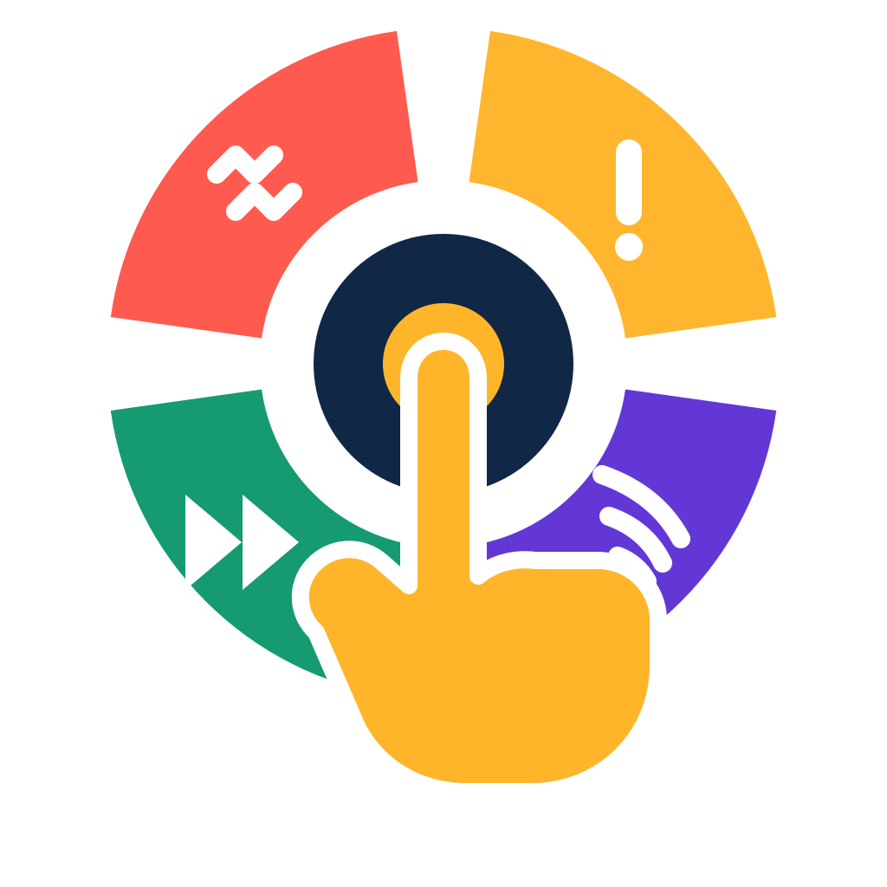
</p>

An open-source, service-neutral touchscreen console for production-line incident
reporting and first-response coordination. Operators identify affected stations and
failure modes, report interruptions, request departmental support, track responders
and repair time, coordinate planned engineering work, and restore the line through a
guided workflow.

**FloorTerminal** describes exactly where the product belongs: it is the dedicated
terminal at the production floor where an operator begins the response. Its visual
identity follows the same workflow—fault, report, coordinated response, and restored
production, all initiated by one deliberate touch. The project remains independent
of any particular factory, external service, or maintenance platform.

It is designed for Raspberry Pi kiosks and desktop development. It is not a PLC,
safety HMI, machine controller, CMMS, shift-reporting system, or attendance tool. It
never replaces lockout/tagout, guarding, emergency-stop, permit-to-work, or site
escalation procedures.

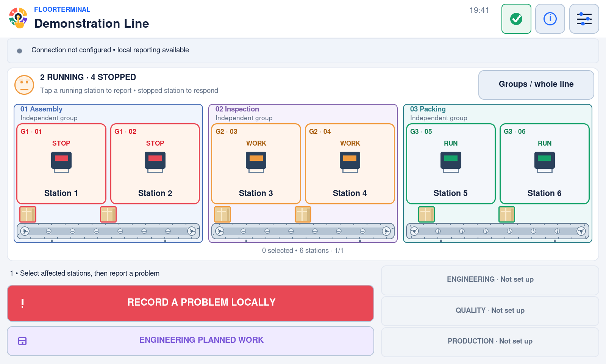

**The gallery shows the released v1.2.0 application**, freshly rendered on the Pi
using disposable offline fixtures. Here, separate group borders and conveyor segments
make stopped, responding and running areas visible together. Click any screenshot
for its native pixels; none is enlarged or manually redrawn.
Unavailable support buttons mean no external connector was configured for the
capture. Some test-driver views use an in-memory service fixture, never a real account.
Update examples are explicitly illustrative, not future-release announcements.
[Full gallery, capture method and provenance](docs/images/README.md).

### See the v1.2.0 workflow

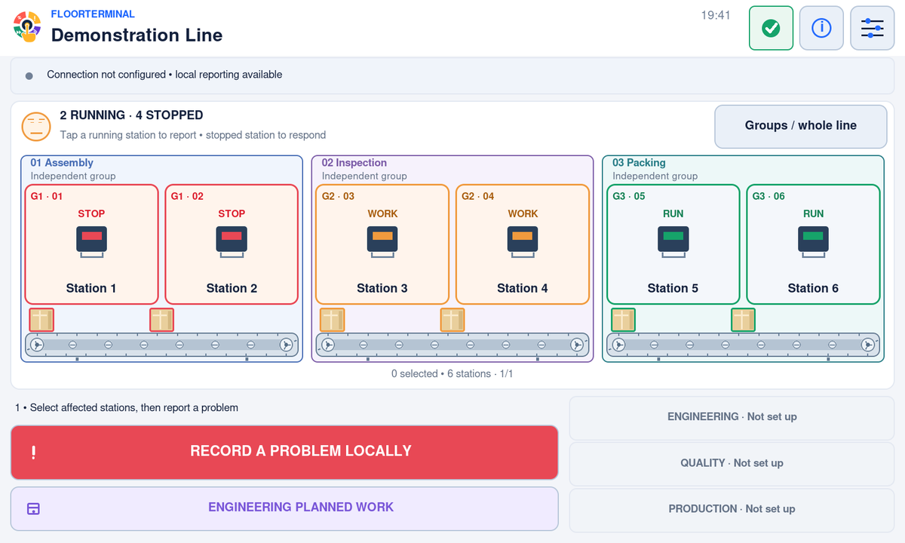

Only the running group's conveyor moves; reporting one group does not automatically
stop the others. These clips show real renderer output at fixed 24-fps animation
steps, not a device-performance benchmark. [Group setup and impact rules](docs/station-groups.md).

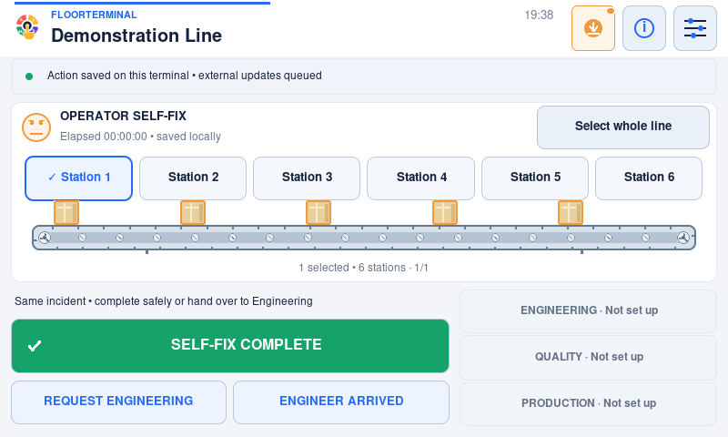

Operators can finish an allowed minor stoppage themselves or request Engineering
on the **same incident**, keeping its timing and context. [Self-fix and handover](docs/operator-self-fix.md).

The built-in Information panel keeps project ownership, support, licensing, and
deployment responsibility visible on every installed terminal.

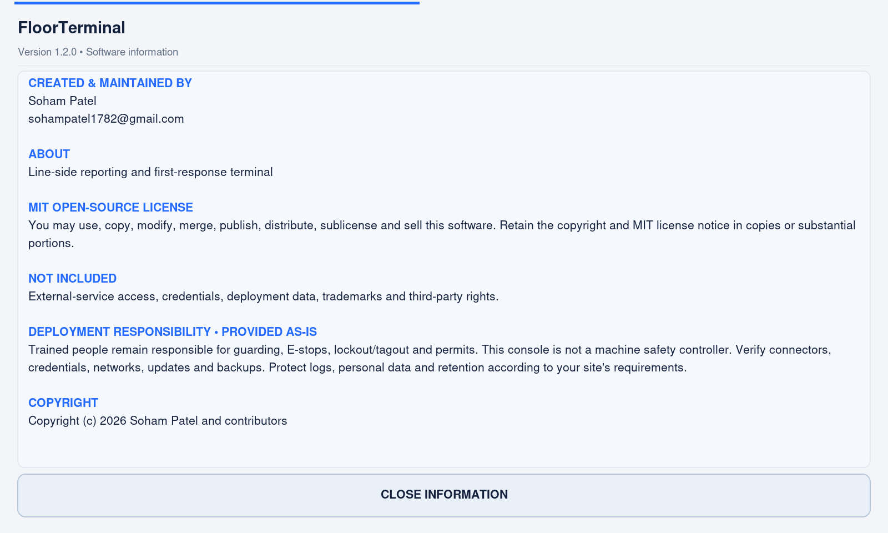

## What it provides

- Touch-first selection of any number of stations or the entire line.
- Per-station failure catalogues: Others only, or any number of custom reasons;
  responsive touch selection, search and paging without losing selections.
- Local-first event persistence, downtime/repair timers, and restart recovery.
- v1.2.0: persistent team names, daily idle-time refresh and a manual
  Settings refresh—no directory read on each crew-picker opening.
- Unplanned interruption and planned Engineering workflows.
- v1.2.0: operator-resolved minor stoppages, with an optional name and
  same-incident Engineering handover if help is needed.
- v1.2.0: independent production groups, concurrent responses and
  group-specific conveyor/status displays; each group can stop itself or the
  whole line. [Setup, connector mapping and overlap rules](docs/station-groups.md).
- v1.2.0: private local incident history and deliberate standalone
  reporting, with automatic bounded retention. [Storage and backup guide](docs/local-history.md).
- Multiple responders whose participation can be edited during active work.
- Message-only Engineering, Quality, and Production support requests.
- Independent response-record, messaging, directory, assignment, and asset capabilities.
- Queued, rate-limited synchronization after connectivity loss.
- v1.2.0: independent background delivery, restart-safe incident
  queues, cached responder lists and protected review of uncertain writes.
  Small request budgets resume directory reads; local saves leave animation
  running and show progress until storage confirms the action.
- Touchscreen and desktop layouts; v1.2.0 adds portrait, landscape
  and short-window reflow without a configured display resolution.
- Status-aware line animation, accessible redundant status cues, and optional sound.
- v1.2.0: automatic bounded audit retention and background device checks;
  housekeeping never removes pending reports or incident-recovery data.
- Signature-verified offline USB software updates with one-touch verified rollback.

## Download the ready-to-use Raspberry Pi build

The [v1.2.0 release](https://github.com/thesohampatel/floorterminal/releases/tag/v1.2.0)
contains the ready-to-run Linux ARM64 installation bundle and signed USB update.
Compiled binaries are distributed separately from the source repository. For a
different operating-system ABI or architecture, follow the [source build guide](docs/building.md).
The Raspberry Pi 64-bit ARM application bundle contains the executable, installer,
autostart/service definitions, neutral configuration, Connector v1 template, license,
notices, SBOM, deployment instructions, and checksums.

Download the installation archive and its
[SHA-256 file](https://github.com/thesohampatel/floorterminal/releases/download/v1.2.0/floorterminal-v1.2.0-linux-arm64.tar.gz.sha256):

```text
floorterminal-v1.2.0-linux-arm64.tar.gz
```

This is an application bundle—not a Raspberry Pi OS disk image. Install Raspberry Pi
OS 64-bit with a graphical session first; then download and extract the bundle on the
Pi. The short installation path is:

```bash
sha256sum -c floorterminal-v1.2.0-linux-arm64.tar.gz.sha256
tar -xzf floorterminal-v1.2.0-linux-arm64.tar.gz
cd floorterminal-v1.2.0-linux-arm64
sha256sum -c SHA256SUMS
chmod +x install.sh floorterminal-launch floorterminal
./install.sh
sudo reboot
```

The standard release initial Settings password is **`admin@123`**. This is a
deliberately public setup password, not a secret or a permanent master override.
Open **Settings → System → Change Settings password** before production use.
Verify the current password, enter a new one, and confirm it. The new password
takes effect immediately on that installation and survives restarts and updates;
the initial password then stops working. See [Settings access](docs/settings-access.md).
Configure the line in protected Settings and provide a deployment-specific
`connector.json` only when an external system is required.

Read [Prebuilt Raspberry Pi installation](docs/prebuilt-raspberry-pi.md) before using
the release. It covers compatibility, download verification, first boot, fullscreen
kiosk behavior, connector setup, service status, logs, upgrades, rollback, and
troubleshooting. Later versions install offline from a signed USB drive; see the
[update guide](docs/update-user-guide.md). Users who do not trust or cannot use the prebuilt artifact can follow
[Native release builds](docs/building.md) to reproduce it from source on their Pi.
Compatibility and verification results are documented in
[Version 1.2.0 release notes](docs/releases/v1.2.0.md),
[version 1.1.0 release notes](docs/releases/v1.1.0.md) and
[version 1.0.0 release notes](docs/releases/v1.0.0.md).

## Software updates

A small indicator beside the information button reports whether the terminal runs
the newest published version. It is green when up to date, amber when something is
waiting, and red when availability could not be checked. Every colour is
non-blocking: reporting, timers, connectors, and Settings behave identically.

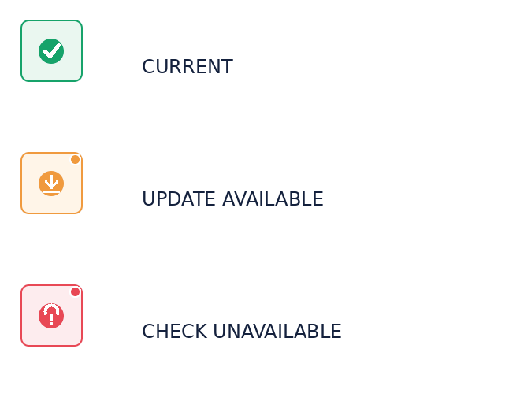

Updating is offline and manual. Download the update-drive archive from the Releases
page on any computer, extract it onto a USB drive labelled `FLOORTERM`, and plug the
drive into the terminal. The terminal verifies the maintainer's Ed25519 signature and
the executable checksum by itself, then waits for an administrator to authorize the
change on the touchscreen.

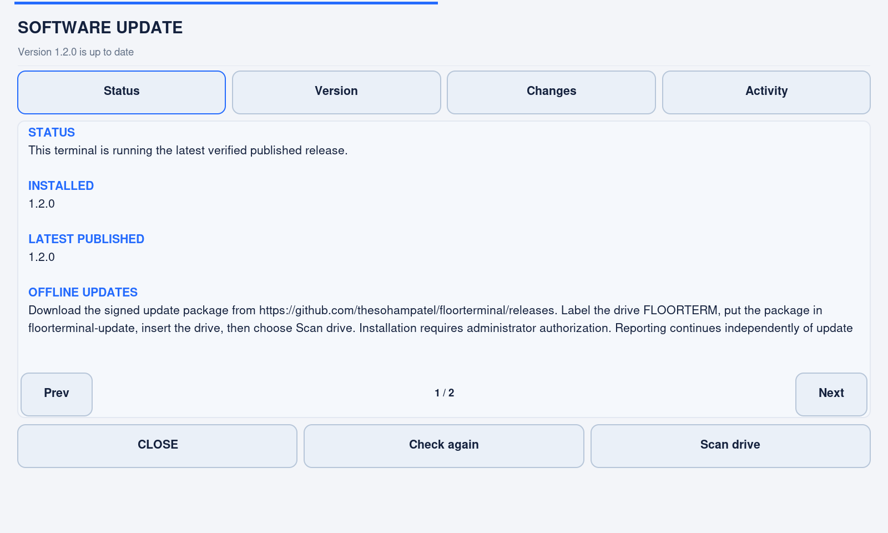

The current-version screen above is a v1.2.0 documentation fixture. The update
guide also shows hypothetical next-version states so administrators can recognize
them; only the public Releases page determines what can actually be downloaded.

Each release is installed in its own version slot and selected by one symbolic link.
The v1.2.0 updater checks saved-data compatibility and creates private
local checkpoints before changing versions. Compatible connector files stay intact;
missing configuration extensions lost by an older Settings writer can be restored
without overwriting current edits. Unsafe downgrades are refused instead of dropping
features or pending reports. Finish responses and synchronization before updating,
then allow the two-minute GUI health check to complete. The previous executable
stays installed for verified recovery. See [data preservation and compatibility](docs/update-data-compatibility.md).

Read the [step-by-step update guide](docs/update-user-guide.md) for the operator
procedure and [Offline software updates](docs/software-updates.md) for the complete
specification, formats, integrity checks, and failure analysis. When several
releases or USB packages exist, see [version selection and rollback](docs/update-user-guide.md#multiple-available-versions).

## Operator workflow

**New in v1.2.0:** touch a station, optionally touch a failure reason,
then **Report • Engineering** or **Start self-fix** on that same screen: the normal
single-station report takes 2–3 taps. Arrival, one-person crew changes and safe
completion take 2 taps when the name is visible in the saved team list.
**Keep selection / more stations** preserves multi-select; **Select several**
preserves batch crew edits. Optional details and finding a name take extra taps.
See the [touch-flow guide](docs/operator-touch-flow.md) for exact steps and limits.
Self-fix is only for permitted minor work. **Request Engineering** and
**Engineer arrived** are direct actions on the active screen and hand the
same incident to Engineering without resetting its downtime. See the
[operator self-fix walkthrough](docs/operator-self-fix.md) for all paths, messages,
offline behaviour and safety limits. The walkthrough below shows the Engineering
path; the linked guide also illustrates self-fix and handover.

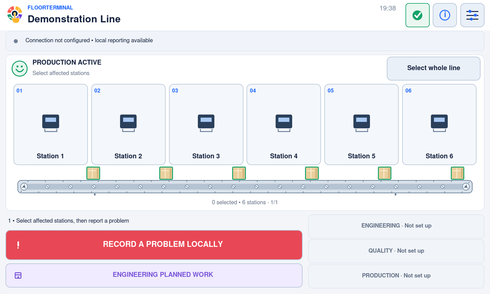

The walkthrough uses example state rendered by the application, with no external
request. For a non-animated reference, open the [running screen](docs/images/v1.2.0/operator-console.png),
[interruption screen](docs/images/v1.2.0/line-interrupted.png), or
[repair screen](docs/images/v1.2.0/response-in-progress.png).

```text
RUNNING → select station(s) → optional failure type(s) → report problem
        → local event + external sync → responder(s) arrive → repair
        → approved completion → production restored
```

### 1. Identify the affected area

Touch one or more stations, or **Select the entire line**. Each station has its own
failure list. Selecting a failure is optional, so an unknown cause never prevents a
report. **Others** permits an optional touchscreen note.

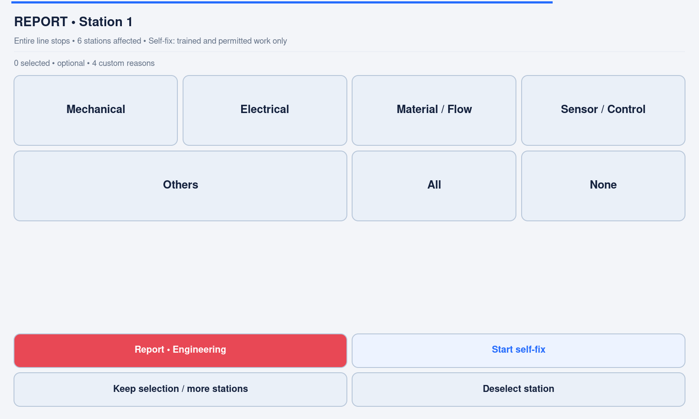

### 2. Report the interruption

Use **Report • Engineering** on the station sheet, or choose the appropriate
Engineering/self-fix path from the main reporting control. This deliberately records
the stop; there is no redundant confirmation on the short Engineering path. The console
persists the report ID, selection, time, and timer before attempting a network call.
When supported, the connector creates a detailed response record, assigns the configured
team, posts lifecycle messages, and marks the asset unavailable. Retries reuse one
durable event key. Safely replayable creates require real remote deduplication;
native endpoints without it use explicit hold-on-ambiguity and administrator review.

### 3. Record the response

Responders select one or several directory names. The selection can be reopened so a
person can join or leave while repair remains active. Participation and timing are
kept locally and synchronized only through supported connector capabilities.

### 4. Restore production

After site-required inspection and production release, complete the work. The console
records duration and participants, classifies micro-stops, closes the response record,
posts completion, and returns the asset to available status where supported.

**Engineering planned work** follows the same timer, response, and restoration
discipline with distinct planned-event text. Support buttons only send contextual
messages; they do not create response records. A configurable unanswered-event escalation
is sent once. A persistent badge exposes queued synchronization and manual retry.
Record updates and chat notifications that cannot be delivered — during an outage or
while the connector's request budget is spent — are queued in the saved state and
retried automatically, including after a restart. A failed action is explained in a
message that names the operation and stays until acknowledged.

Read the complete [operator guide](docs/operator-guide.md).

**v1.2.0:** reporting, repair and production release no longer wait
for a remote record ID. A durable local journal sends supported operations through
one independent background worker, respects quota pauses and resumes after restart.
Touch the queued-updates strip for **Saved updates**; uncertain non-idempotent
writes require review instead of blind replay. See
[offline reporting, capacity limits and recovery](docs/offline-delivery.md).

## Interface and animation

**v1.2.0:** the kiosk now reflows across landscape, portrait, square
and ultrawide windows. It does not require a configured display resolution. On a
short screen, the station map and primary actions stay together; on a narrow
screen, actions stack vertically. Station pages preserve process order and whole-line selection. Settings
fills the kiosk; long forms have touch-sized Previous/Next controls and optional
drag/wheel movement, while dialogs keep their action buttons visible.
See [adaptive kiosk layouts and commissioning](docs/adaptive-kiosk.md) for the
usability minimum, native preview images, verification and physical-screen checks.
All linked interface images were refreshed from the released v1.2.0 source,
including group, self-fix, crew, failure catalogue and Settings screens.

The production map is a unidirectional line. Conveyor rollers, drive elements,
process indicators, and products animate only while running; motion and borders
change during downtime, response, and planned work. Status uses words, glyphs/faces,
borders, motion, and color so color is never the only signal. Layout derives from the
active window dimensions rather than a hardcoded resolution, and dialogs remain
inside the current display.


This clip uses real application-rendered frames at fixed 24-fps animation steps.
It is downsampled from native 1600×960 frames to reduce download size; none of the
documentation images is upscaled. Measured kiosk performance is documented
separately in [verification](docs/verification.md).

## Settings at a glance

Open the sliders button, identify the administrator, and enter the Settings password.
Changes are validated before saving. All six categories remain accessible on small displays;
long administrative forms page (or optionally scroll). The operator's failure
picker shows reasons together when they fit; larger lists use touch paging and
Find, never tiny buttons or a scrolling list. Others and reporting actions remain
reachable on every page. Narrow Settings pages use Previous/Next category
controls, and Save/Cancel stay outside the form. Password/text screens remain
fullscreen inside the same kiosk, never in an independent desktop window.

| Category | What you configure |
|---|---|
| General | Line identity, local operating preferences and workflow choices |
| Connector | Discovered files, validation results, application request budget, departmental destinations and saved-team refresh |
| Stations & failures | Any number of named stations and each station's own failure list |
| Messages | Event titles, descriptions and support-message templates |
| System | Security, sound, animation and read-only automatic device-care status (v1.2.0) |
| Colors | Consistent display palette |

[Automatic device care](docs/automatic-device-care.md) explains disk budgets,
adaptive retention, cleanup boundaries and warnings. Log tuning is no longer an
operator task in v1.2.0; pending reports are never removed to free space.

[Saved team members](docs/team-roster.md) explains the daily refresh, manual
**Refresh team members** control and offline behavior. Names are cached in private
runtime state, not inserted into the connector or editable configuration.

<details>
<summary>View high-resolution Settings screenshots</summary>

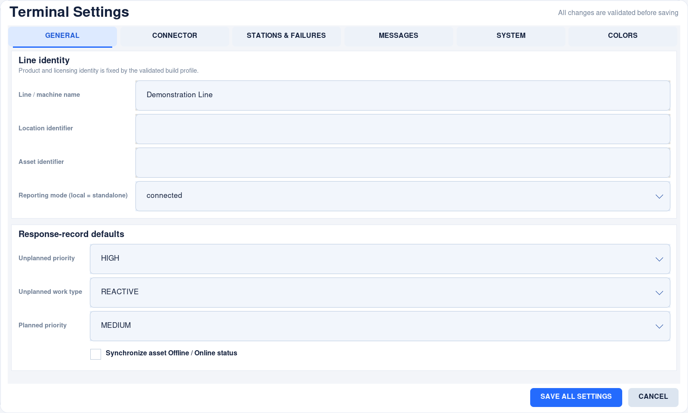
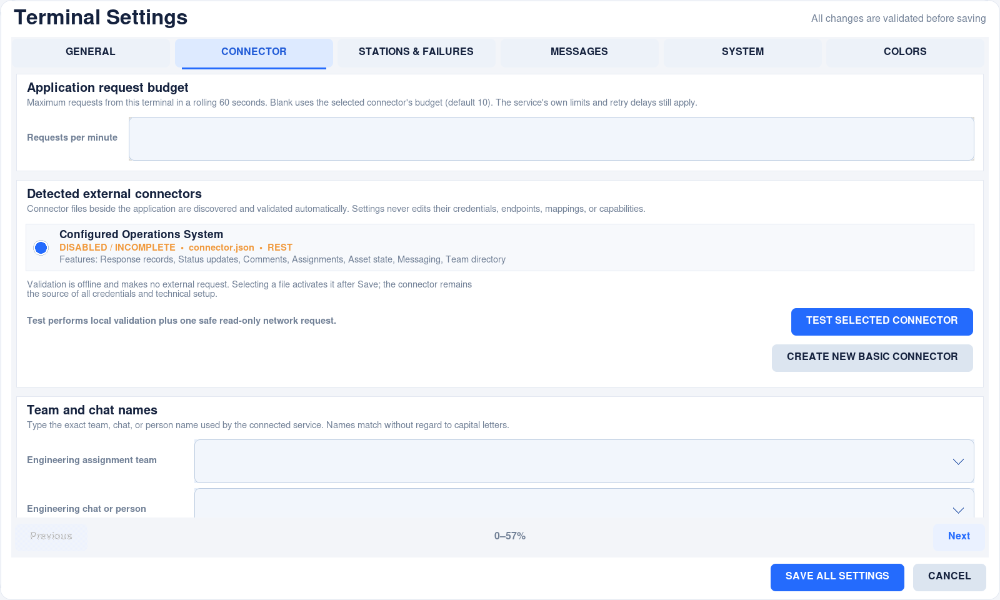
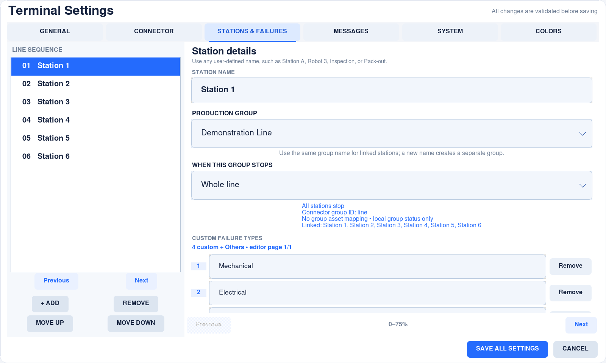

</details>

Connector credentials, endpoints and response mappings are maintained in the
deployment-owned connector file, not typed into ordinary application fields.
Opening Settings validates files locally. **Test selected connector** can make an
explicit safe read-only network request; use it only with the site owner's approval.
See [configuration](docs/configuration.md) and the [Connector v1 guide](docs/connector.md).

## Operational sounds

Sounds are optional, non-blocking, and supplementary to visual status.

| Cue | Meaning |
|---|---|
| `alert` | New interruption or escalation |
| `response` | Response/repair began or changed |
| `restored` | Work completed and production restored |
| `planned` | Planned Engineering possession began |
| `support` | Department support request sent |
| `error` | Operator-visible error needs attention |

Settings provides enable/disable, volume, repeat cooldown, and **Test sound**. Linux
prefers `paplay` and falls back to `aplay`; macOS uses `afplay`; Windows uses
`winsound`. Playback runs on daemon workers and backend failure never blocks reporting.

All WAV files are original deterministic tones generated by
[`scripts/generate_sound_assets.py`](scripts/generate_sound_assets.py). No audio was
downloaded and no sample, voice, music recording, trademark sound, or third-party
copyrighted material is included. See [Sound and accessibility](docs/sound.md).

## Run from source

Requires Python 3.11+, Tk/Tcl, and a graphical display session. Sound is optional.

```bash
git clone https://github.com/thesohampatel/floorterminal.git
cd floorterminal
python3 scripts/setup_runtime.py
python3 main.py
```

The setup script creates ignored runtime files from neutral examples. Integration is
disabled and credential-free by default, so the full local UI can be evaluated
without a network or external account. Initial Settings access is `admin@123`;
change it from the System tab. Custom builds can use a private initial password
as described in [Project profile](docs/project-profile.md).

## Configure stations and failures

Use protected Settings or edit owner-only `config.json` while stopped:

```json
{
  "line_name": "Demonstration Line",
  "zones": ["Station 1", "Station 2", "Inspection"],
  "station_failure_types": {
    "Station 1": ["Material feed", "Guard", "Sensor", "Drive"],
    "Station 2": ["Alignment", "Tooling", "Sensor", "Jam"],
    "Inspection": ["Vision", "Gauge", "Fixture", "Data"]
  },
  "sound_enabled": true,
  "sound_volume": 70,
  "sound_cooldown_ms": 750
}
```

Every station needs its own custom-reason array. Use `[]` for **Others only**, or
add as many unique, nonempty printable reasons as needed. **Others** is added
automatically and must not be listed in JSON. There is no fixed count limit;
configuration and recovery-file size safeguards still apply. Names are arbitrary;
no station naming convention is required. Existing four-reason lists still work.
See [failure catalogue setup and selection](docs/failure-reasons.md).
See the complete [configuration reference](docs/configuration.md).

## Connect an external system

There is no hardcoded provider API, provider name, key, or executable plugin. A
deployment-owned Connector v1 JSON file beside the executable describes HTTPS
authentication, operations, field/value mappings, capabilities, response rules,
rate limits, and idempotency.

1. Copy `connector.example.json` to ignored/deployed `connector.json`.
2. Configure an HTTPS base URL and exact host allow-list.
3. Add credentials only to that file and use `chmod 600 connector.json` on Linux.
4. Enable only capabilities the service genuinely supports.
5. Define operations, request mappings, response extraction, and lifecycle values.
6. Configure remote-enforced idempotency for every create capability.
7. Open Settings to review readiness and capabilities.
8. Run **Test selected connector** only against an authorized non-production system.
   It issues at most one declared safe GET and never modifies remote data.
9. Complete the acceptance matrix before production.

Capabilities degrade independently: absent messaging disables support/chat actions
without breaking local reporting or correctly configured response-record/asset features.
Multiple files can be discovered, but only one validated connector drives a terminal.
Read the full [Connector v1 contract](docs/connector.md).

Use the [connector commissioning checklist](docs/connector-commissioning.md) to map
record creation, assignments, asset history, group/person messaging, pagination and
delivery guarantees. The application never assumes that a remote status change
starts a labor timer, or that an arbitrary header prevents duplicate records.

## Raspberry Pi 64-bit build and kiosk

Build on the target OS/architecture; PyInstaller is not a cross-compiler:

```bash
sudo apt update
sudo apt install -y python3 python3-tk python3-venv alsa-utils
python3 scripts/setup_runtime.py
./scripts/install/prepare_release_on_pi.sh
```

The Pi release wrapper supplies a private Xvfb display while testing, so the native
build cannot pass by silently skipping the touchscreen render/control/layout sweep
in a display-less SSH session.

Tk requires a graphical display server/compositor even when panels and desktop icons
are hidden. The Linux installer uses `/opt/floorterminal`, preserves existing
deployment config during upgrades, and configures user-systemd supervision plus
graphical-session startup. Unexpected exit restarts the kiosk.

See [Building](docs/building.md), [Operations](docs/operations.md), and
[industrial acceptance](docs/industrial-deployment.md).
For Pi 5 resource behavior, safe local files, hardware checks and commissioning,
see [Pi kiosk hardening](docs/pi-kiosk-hardening.md).

## Release contents and safeguards

The builder validates config, source, tests, Tk, disk, platform, legal/localization/
sound assets, and dependencies. It does not download packages or call a connector.
The release includes the native app, neutral config, disabled empty-credential
connector, MIT license, notices, SPDX SBOM, checksums, instructions, and platform
files. It rejects secrets, private plaintext passwords, enabled integrations, source,
bytecode, logs, and runtime state. Owner build records are ignored private artifacts.

Security controls include HTTPS and host allow-lists, no redirects, bounded responses,
data-only connectors, a configurable rolling-minute application budget, 90% shared
limit warning, atomic owner-private files, stable retry keys, strict state recovery,
PBKDF2 Settings authentication, progressive throttling, authorized kiosk exit,
symlink-resistant/redacted audit logs, and fixed no-shell audio commands. Software
updates add build-time trusted Ed25519 signing keys, an immutable release endpoint
and media identity, data-only removable media that is never executed, atomic version
switching, supervised automatic rollback, and attributed authorization.

This is not a certified safety system. Deployment owners remain responsible for risk
assessment, network segmentation, OS hardening, least privilege, backups, time sync,
change control, validation, training, accessibility, incident response, privacy, and
applicable industrial/cybersecurity obligations.

## Offline verification

```bash
python3 -m compileall -q src tests scripts main.py
ruff check src tests scripts main.py
FLOORTERMINAL_DISABLE_NETWORK=1 PYTHONPATH=src python3 -m unittest discover -s tests -v
```

Tests use fake in-memory transports and never call an external API. They cover state,
connectors, request budgeting, idempotency, capability isolation, workflows, sound
assets/backends, security controls, and release inputs. The process-level offline
guard blocks both real application transports, including a manual update check;
injected in-memory transports remain usable for tests. No connector credentials
are needed.

The automated integrity checks verify the public file set, signed channel, version
agreement, and pinned CI actions. See [verification scope](docs/verification.md)
for measured results and deployment limitations.
For an authorized spare-terminal test on the actual display, use the
[isolated fullscreen panel check](docs/pi-kiosk-hardening.md#checking-a-physical-panel-safely).
It does not install development code over a production release.

## Repository map

```text
main.py                              source entry point
config.example.json                  neutral runtime configuration
connector.example.json               disabled Connector v1 template
project_profile.example.json         neutral build identity template
src/floorterminal/
  app.py                             application lifecycle
  controller/                        workflow, dialogs, and update controls
  audio.py                           asynchronous sound service
  assets/sounds/                     original generated WAV cues
  assets/branding/                   packaged runtime identity sizes
  core/ integration/ services/       application and connector layers
  storage/ ui/                       persistence and responsive touchscreen
  update/                            signed offline update subsystem
branding/floorterminal/              original SVG mark and raster exports
scripts/setup_runtime.py             create ignored runtime files
scripts/generate_sound_assets.py     reproducible tone generator
scripts/build/                       audited native release pipeline
scripts/release/                     offline update signing and packaging
packaging/linux/                     Raspberry Pi deployment files
update-channel/                      published signed availability document
tests/                               offline unit/integration tests
docs/                                operations, API, assurance, and user docs
```

## Documentation and project policy

- [Operator guide](docs/operator-guide.md)
- [Adaptive kiosk layouts and native previews — v1.2.0](docs/adaptive-kiosk.md)
- [Rendering, touch feedback and measured performance](docs/ui-performance.md)
- [Prebuilt Raspberry Pi installation](docs/prebuilt-raspberry-pi.md)
- [Update guide](docs/update-user-guide.md) and [offline software updates](docs/software-updates.md)
- [Offline reporting and saved-update recovery](docs/offline-delivery.md)
- [Version 1.1.0 release notes](docs/releases/v1.1.0.md)
- [Version 1.2.0 release notes](docs/releases/v1.2.0.md)
- [Version 1.0.0 release notes](docs/releases/v1.0.0.md)
- [Configuration](docs/configuration.md) and [Connector v1](docs/connector.md)
- [Saved team members and daily directory refresh](docs/team-roster.md) — v1.2.0
- [Per-station failure reasons](docs/failure-reasons.md) and [independent production groups](docs/station-groups.md) — v1.2.0
- [Sound](docs/sound.md), [Accessibility evidence](docs/accessibility.md), [Architecture](docs/architecture.md), and [Operations](docs/operations.md)
- [Requirements traceability](docs/traceability.md) and [product lifecycle](docs/lifecycle.md)
- [Building from source](docs/building.md) and [verification scope](docs/verification.md)
- [Security policy](SECURITY.md), [baseline](docs/security.md), and [threat model](docs/threat-model.md)
- [Contributing](CONTRIBUTING.md),
  [Governance](GOVERNANCE.md), and [Support](SUPPORT.md)

FloorTerminal is open-source under the [MIT License](LICENSE). Preserve the
notice in copies or substantial portions. The software is provided without warranty.
External API terms, credentials, data, connector correctness, deployment fitness,
and operational safety remain the deployer's responsibility.

## Developer, maintainer, and help

FloorTerminal was developed and is maintained by **Soham Patel**.

- Email: [sohampatel1782@gmail.com](mailto:sohampatel1782@gmail.com)
- GitHub: use this repository's Issues area for non-sensitive questions, defects,
  feature proposals, and documentation improvements.

For help evaluating the project, setting up a Raspberry Pi kiosk, configuring a
production line, preparing a Connector v1 definition, or integrating the console
with an end-user system, contact Soham by email or through GitHub. Never include API
keys, passwords, production URLs, employee data, or sensitive operational logs in a
public issue. Support is best-effort and does not change the MIT License's no-warranty
terms or create a guaranteed response time.
