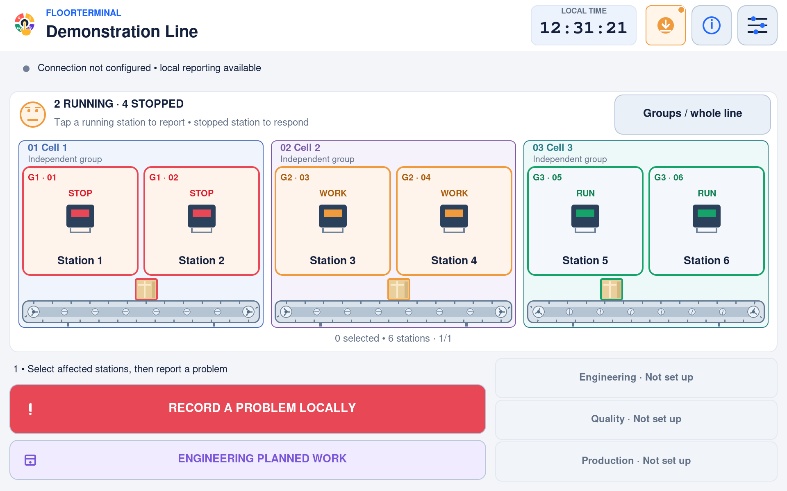
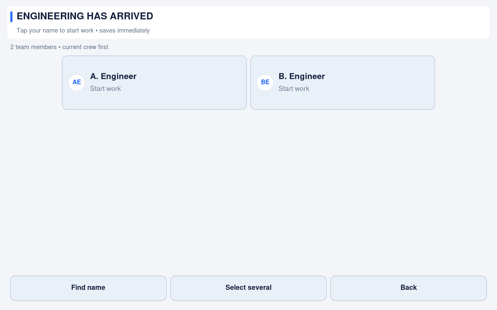
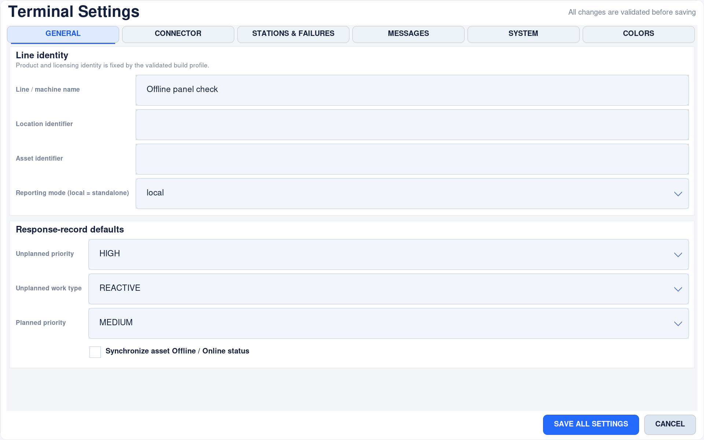
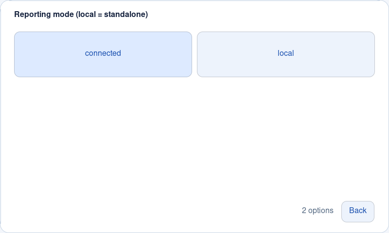
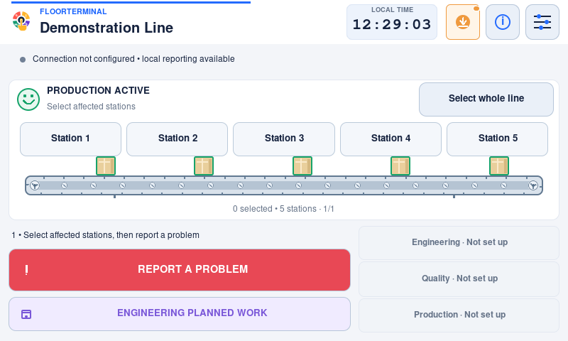
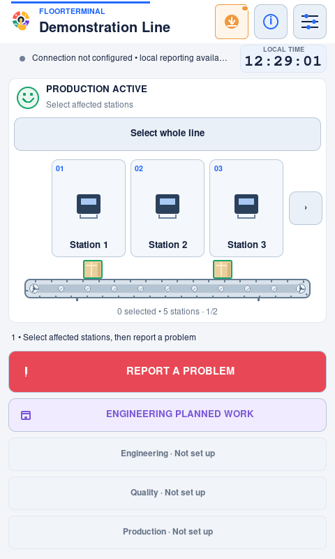
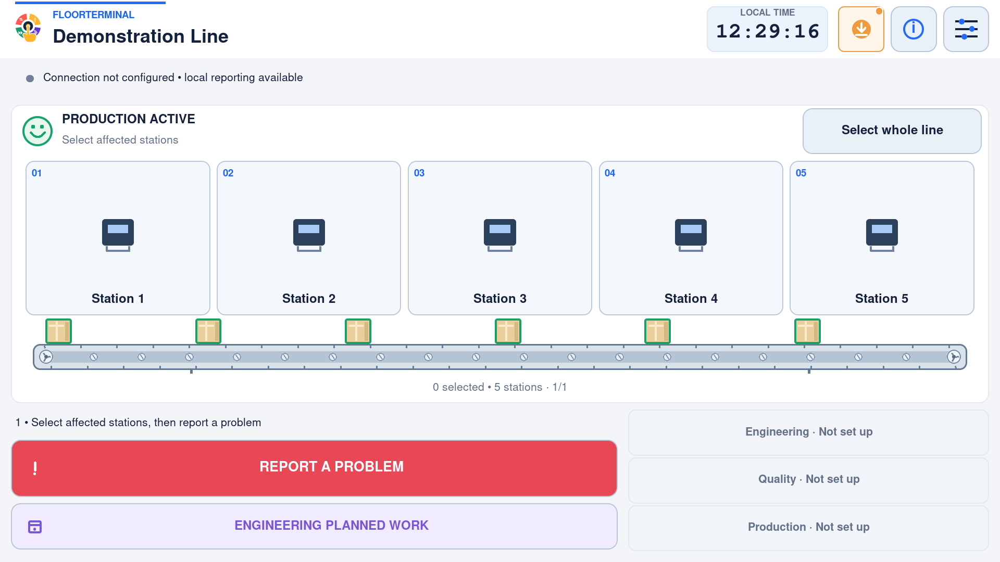
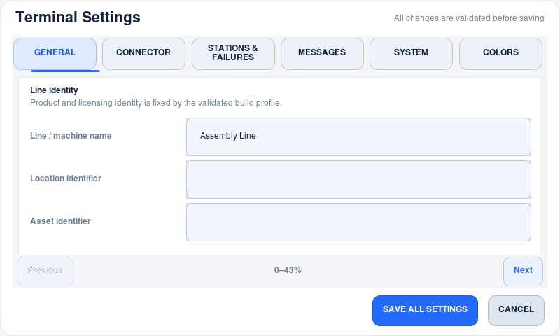
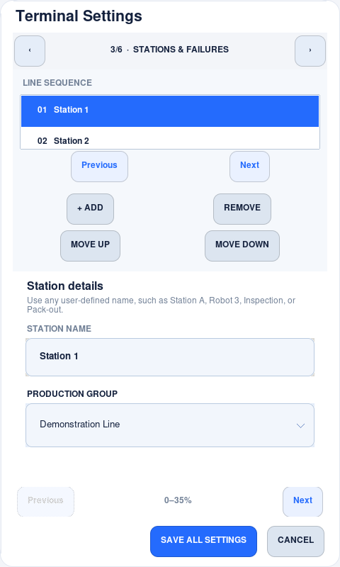
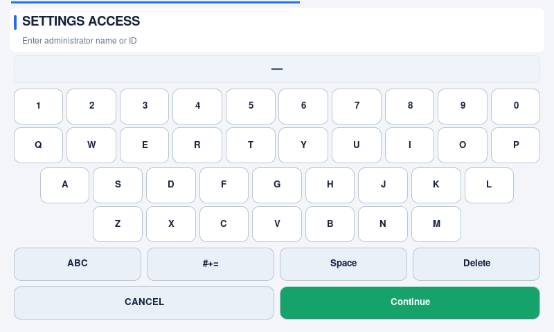

# Adaptive kiosk interface — v1.2.1

FloorTerminal lays out the interface from the window it actually owns, not from a
list of supported monitor models. Display size is not a configuration field.
These controls require v1.2.0 or later; use the version published for your platform.

## Operator layout

The normal reading order is identity, connection/feedback, line status and
stations, the next workflow action, and optional support calls.

- **Landscape:** workflow and support actions sit beside one another beneath the
  line. Primary actions are visually stronger than secondary actions.
- **Portrait/narrow:** actions stack, preserving full department names and touch
  areas. The conveyor remains horizontal and one-directional.
- **Short windows:** a compact station map stays above the workflow controls;
  there is no separate Actions page. Controls keep their minimum touch size.
- **Many stations:** Previous/Next pages follow the configured order. Capacity is
  calculated from row width, not capped to one particular station count. Whole-line
  selection includes stations on every page.
- **Feedback:** a dedicated band never covers stations or workflow buttons.
  Accepted touches depress the control and show a brief ring. Operations keep a
  spinner and elapsed time; tap a message for its complete text. Acknowledging a
  touch is not confirmation of remote acceptance.

The product animation is secondary to controls: small line regions omit the belt
when there is not enough space. Status words, selection and workflow stay usable.

## Every dialog follows the same rules

Failure choices, crew selection, password/text entry, confirmation, Information,
errors and Software Update remain inside the app. Their controls share the same
coordinate transform as the displayed content.

The usual four custom reasons plus Others, All/None and report actions stay
together, including at the 320×400 logical minimum. Larger catalogues use a
bounded grid with Find and touch paging; Others remains on every page and the
report footer never moves off-screen. No list-size-driven widget tree is created.
Crew and group overviews use responsive grids;
**Find name/group** filters lists larger than the visible capacity instead of
requiring repeated Next pages. Current crew appear first and joining/leaving edits
remain attached to the current event. Batch crew choices survive filtering.
Long Information, error and update text is
wrapped using actual font measurements and paged without discarding paragraphs.

The on-screen keyboard pages when all keys will not fit. **More keys**, Shift,
Space, Back, Continue and Cancel remain reachable, including punctuation needed
for passwords. Update installation/restoration still requires administrator
authorization; a compact **Install / restore** page only exposes the existing
authorized workflow.

## Settings

Opening Settings first shows a fullscreen **Preparing controls…** cover with
progress and Back. Construction yields between sections; incomplete form controls
are not exposed. Back cancels a pending build without saving anything. Once ready,
the complete page appears with a brief, bounded transition. A construction error
returns to the existing recoverable application-error panel.

Rounded fields retain keyboard editing. Fixed choices open a fullscreen option
sheet with finger-sized tiles instead of a desktop popup; editable suggestion
fields accept names not yet in the directory. Use the arrow (or F4/Alt+Down) for
suggestions. Long administrative choices have filtering and Previous/Next controls;
Back leaves the value unchanged. Selecting a choice returns to the enclosing form.

Settings fills the same app viewport as the operator screen, without a separate
desktop window or a floating settings rectangle. Password/confirmation screens use
the same fullscreen background, content gutters and pinned action footers.
A wide page shows the six category buttons;
a narrow page shows the current category and large Previous/Next controls.
Labels stack above fields when two columns will not fit. The station list and
failure editor stack too. Longer forms have large Previous/Next controls and
progress indicators; optional dragging and wheel input remain available. Adjacent
pages overlap slightly so partially visible rows stay reachable. Station lists
also have touch page controls. Save/Cancel are outside the form. Resizing does not
rebuild fields or discard unsaved values. Log tuning has been replaced by the
read-only [automatic device-care](automatic-device-care.md) snapshot.

## Native previews

### Released v1.2.1 panel captures — 4 November 2026

These native 1920×1200 captures show the revised grouped map, crew cards and
Settings on the attached Pi display. The group image is an offline rendering
fixture: Cell 1 is stopped, Cell 2 is responding and Cell 3 continues running.
The crew names are synthetic; no real service or credentials are used. All images
on this page were regenerated from the corrected release source; the
[gallery manifest](images/v1.2.2/manifest.json) records their dimensions and hashes.







The compact option sheet uses readable labels and large tiles. Filtering/paging
appears only when needed; Back returns without changing the field.



See [measured responsiveness and remaining limits](ui-performance.md#measured-on-the-attached-pi-5).

### Compact and portrait release captures

These are actual Tk screenshots of the released v1.2.1 interface captured on a
private Raspberry Pi display on 3 November 2026. Each file retains its native
pixel dimensions. The offline fixture enables capability descriptions in memory
to show the available controls; no connector is configured and network calls are
blocked. Station names, failure choices and Settings values are neutral examples.

### Compact landscape — 800×480

The line and primary workflow remain together. Station illustrations give way to
larger text-only station targets when height is limited.



### Portrait — 480×800

Station paging preserves touch size; the workflow and support calls stack.



### Large landscape — 1920×1080

The same interface uses the available space without stretching tiny controls
across the monitor. Open the image to inspect it at its native resolution.



### Settings in both orientations

Category navigation reflows while the form retains unsaved edits. Large page
controls navigate long forms independently of the always-visible Save/Cancel footer.





Also available: [portrait General settings](images/v1.2.2/layout/settings-0-480x800.png)
and [landscape station editor](images/v1.2.2/layout/settings-2-800x480.png).

### Protected kiosk keyboard

Administrator identity/password entry stays inside the same fullscreen page.
Typing and confirmation controls stay visible, without opening a desktop dialog.



## Usability boundaries and commissioning

There is no meaningful way to fit an arbitrary number of finger-sized controls
on an arbitrarily small display. The operational minimum is **320×400 logical
units**. Below that, the app asks for more space rather than accepting touches on
clipped controls; saved workflow and background synchronization are unaffected.
Larger viewports grow the interface gently. Real pixel dimensions, OS scaling,
physical panel size, touch driver accuracy and gloves must be checked on site.

Canvas action targets are at least 44×44 layout units, normally 48 or larger.
This uses the [W3C enhanced target-size guidance](https://www.w3.org/WAI/WCAG22/Understanding/target-size-enhanced.html)
as a design reference, not a claim of web accessibility certification or a
guaranteed physical size. The [W3C reflow guidance](https://www.w3.org/WAI/WCAG22/Understanding/reflow.html)
also motivates keeping content operable without shrinking the entire screen.

Before commissioning, verify orientation/fullscreen, actual touch reach, every
workflow state, long station/crew names, notification readability, Settings
scrolling, native/OS keyboard needs for administrative fields, sound, and recovery
after a restart. Kiosk OS security and machine safety remain separate concerns.

## Offline verification

```sh
PYTHONPATH=src python3 -m unittest discover -s tests -t .
PYTHONPATH=src python3 tests/unit/adaptive_ui_driver.py
PYTHONPATH=src python3 tests/unit/touch_budget_driver.py
PYTHONPATH=src python3 tests/unit/render_stress_driver.py --frames 2000
```

The real-Tk adaptive driver blocks socket connections and uses a disposable
credential-free configuration. It checks 4,632 state/dialog/batch/page combinations at
12 viewports from 320×400 to 2560×720, portrait up to 1080×1920, square and
nonstandard sizes. It checks minimum target size, bounds, intersecting targets,
all 103 sample stations, simultaneous install/rollback controls, and preservation
of unsaved Settings values while the same panel resizes. The existing smoke
driver separately checks drawn text for overlap and checks actual control routing.
Pure geometry tests sweep thousands of additional dimension combinations.

The touch-budget driver completes 65 real-Tk routine paths at five sizes from
320×400 to 1920×1080. It checks actual tap routing, durable state, minimum hitbox
size, overlap and visibility of the default five reasons. The variable-catalogue
driver additionally checks Others-only through 1,000 reasons and preserves drafts
across search, paging and Settings station changes. The
[touch-flow guide](operator-touch-flow.md) explains optional multi-select/search
steps and contains native screenshots from the same v1.2.1 source.
The layout and touch-flow images show the released actions at different sizes.

These checks do not replace hands-on commissioning or a multi-day physical soak.
No external-service API or customer credential is used.
