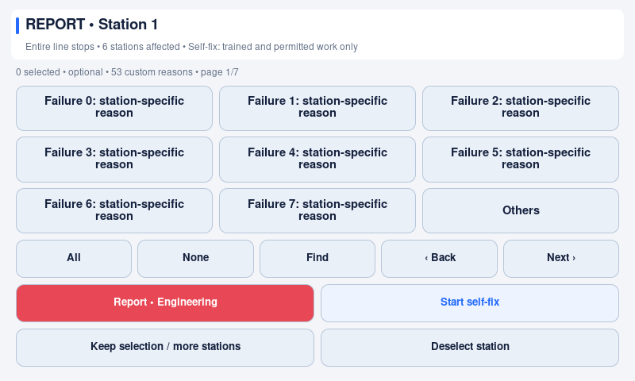
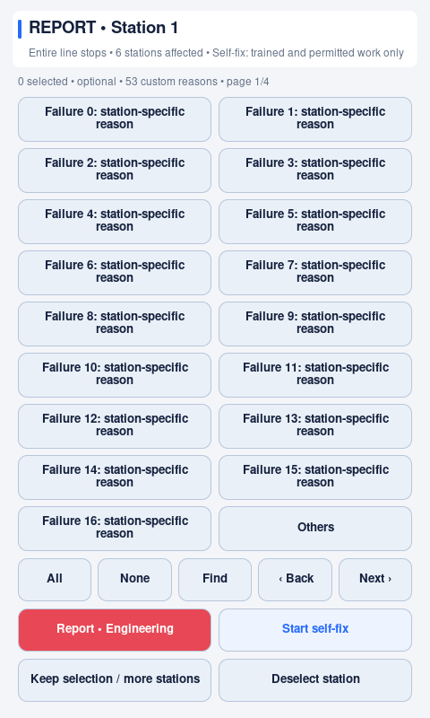

# Per-station failure reasons — 1.2.0

Every station owns its own catalogue, independently of its production group. A
station always offers **Others**, with zero or more custom reasons. There is no
fixed count limit. Reporting without choosing a reason is still allowed; choices
are observations, not mandatory diagnoses or machine-control instructions.

## Set up on the kiosk

1. Open protected **Settings → Stations & failures** and select a station.
2. Edit the visible reason fields. **Add reason** opens an available blank row;
   **Remove** deletes that custom reason. Previous/Next moves through the editor.
3. Leave all rows blank for Others only. Others is automatic and cannot be removed
   or duplicated by entering it as a custom reason.
4. Select another station to give it a different list. Unsaved edits on every
   editor page stay in the Settings draft. **Save all settings** validates and
   saves the complete configuration; **Cancel** discards the draft.

The editor reuses four visible rows rather than constructing hundreds of text
fields. Four is a page capacity, **not** a reason limit. Failure lists cannot be
changed in Settings while any group response is active: this protects the recorded
reason names and notes. Finish those responses first. Completed history and queued
deliveries retain their original detail after later catalogue edits.

## JSON setup

`station_failure_types` must have exactly one key for each station in `zones`:

```json
{
  "zones": ["Feed", "Inspection", "Pack"],
  "station_failure_types": {
    "Feed": [],
    "Inspection": ["Part missing", "Sensor", "Camera", "Gauge", "Fixture", "Data", "Alignment"],
    "Pack": ["Material feed", "Jam"]
  }
}
```

These are the relevant keys, not a complete deployment file. Groups still
partition the same station names; [group setup](station-groups.md) is unchanged.
Use printable, single-line text. Names must be nonempty and unique within each
station, ignoring case and surrounding spaces. Another station may reuse the same
name. Do not add `Others` or `Other` yourself. Missing station lists, non-string
values and duplicates are errors; the application does not silently invent or
truncate a catalogue. Existing one-to-four custom lists need no migration.

## What an operator sees

In **v1.2.1**, every visible reason uses the same card size within a
page, with a centred incomplete final row. Selection/page actions have their own
fixed toolbar. This presentation change does not change the selection rules below.

- Touch a station to open its optional reasons. Nothing is selected by default.
- Small lists fit together; large lists adapt to available width/height and use
  **Back/Next** and **Find**. There is no scrolling operator list, and controls keep
  their touch size. **Others** remains available on every page, including a search
  with no matches. Blank search restores the full list.
- Selections remain selected across pages and searches. **All** selects the entire
  station catalogue, including Others; **None** clears the entire station's
  choices. Neither changes station selection. **Deselect station** does that.
- **Report • Engineering** or **Start self-fix** reports immediately from the
  sheet, even with no reason selected. Self-fix is only for trained, permitted
  work. **Keep selection / more stations** saves the draft for another station.
- **Others → Note / more stations** opens the existing optional 240-character
  note. Selecting Others alone does not force keyboard entry before reporting.

Long labels wrap or abbreviate visually; the original label is retained in saved
selections and report data. Prefer short, distinguishable operator-facing names.
Very large lists need deliberate search/navigation taps; there is no promise that
an arbitrary catalogue can fit into three taps on every screen.

### Native kiosk examples

These are 1.2.0 screenshots from the actual Pi graphical session,
using a disposable 53-reason catalogue and no network connection. Landscape and
portrait show different capacities with the same fixed report controls. They are
native captures, not upscaled mockups; see [image provenance](images/README.md).





## Storage, integration and compatibility

The existing 4 MiB configuration, 32 MiB recovery-state and 2 MiB delivery-journal
bounds remain. These protect kiosk storage/memory; unlimited *count* does not mean
unlimited bytes or an exemption from external payload limits. A capacity failure is
reported without falsely claiming a saved report. Keep catalogues operationally
useful rather than using them as a document store.

Full selected reasons and optional notes stay in the incident/history. Descriptions
include them; short asset/chat summaries remain bounded. An integrator can map
`workflow.fields.failure_details` to a supported structured remote field to carry
the per-station arrays without relying on a short text summary. No remote fault
taxonomy, category ID, asset status or custom field is guessed from a local label.
See [connector mapping](connector.md#mapping-different-data-models).

Older published readers require one to four custom reasons. The 1.2.0 updater
therefore refuses a downgrade with an Others-only or larger catalogue, rather
than dropping reasons or breaking startup. [Update data safety](update-data-compatibility.md).
