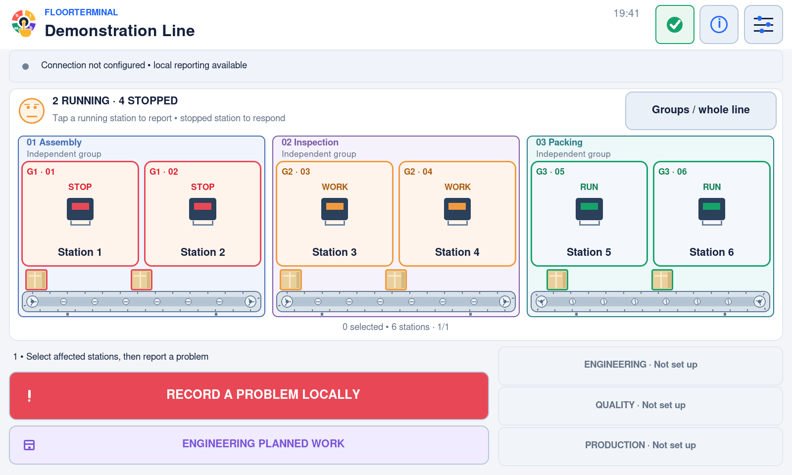
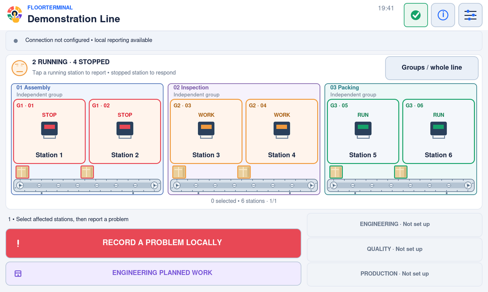
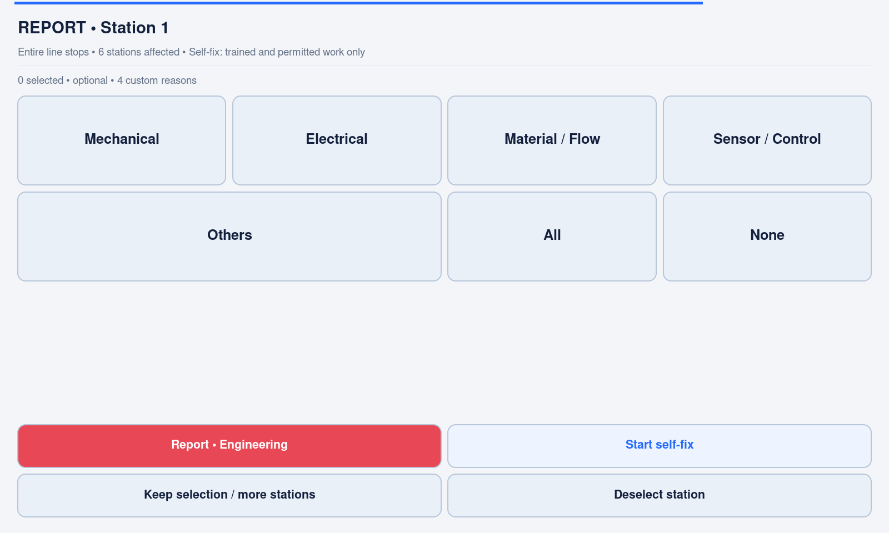
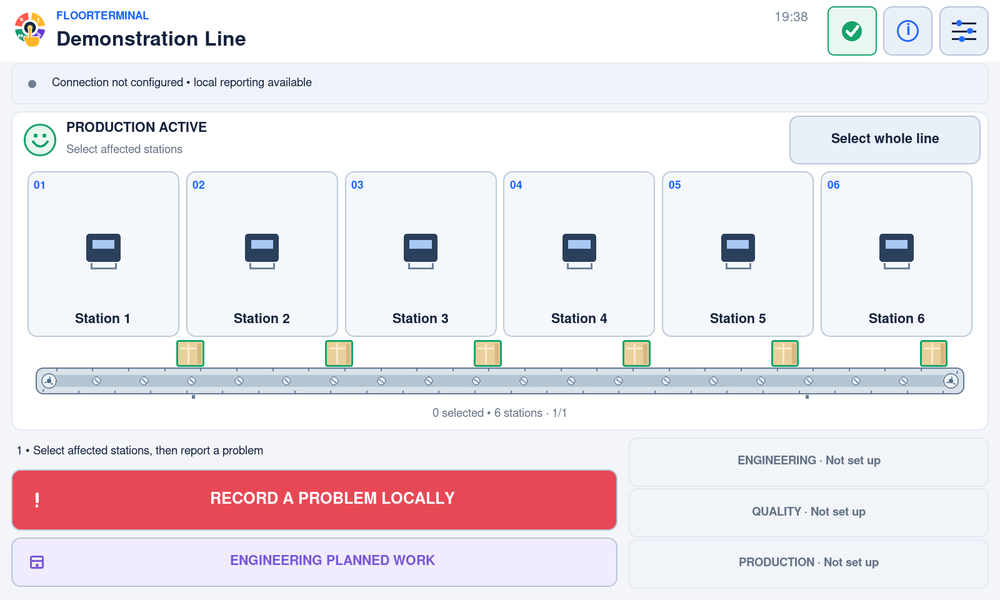
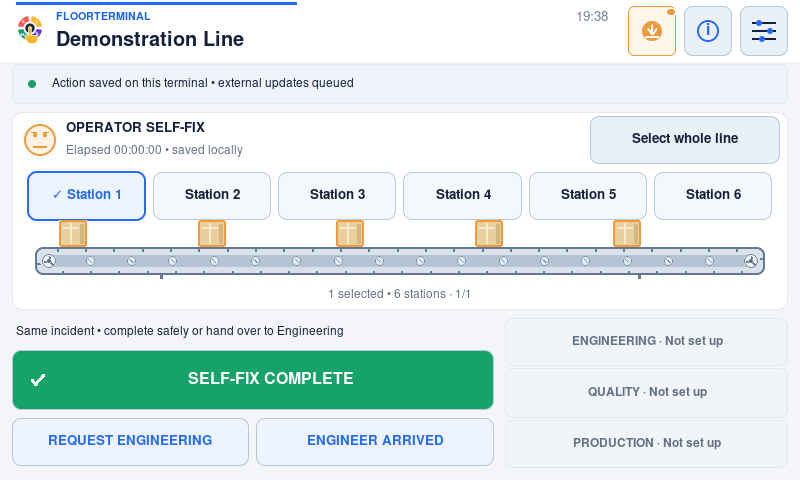
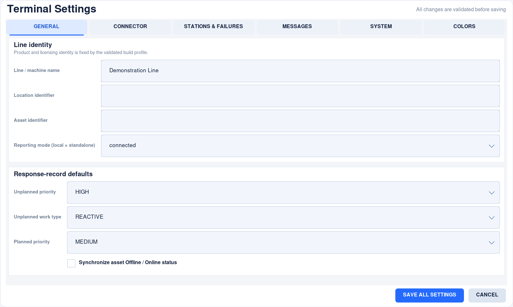
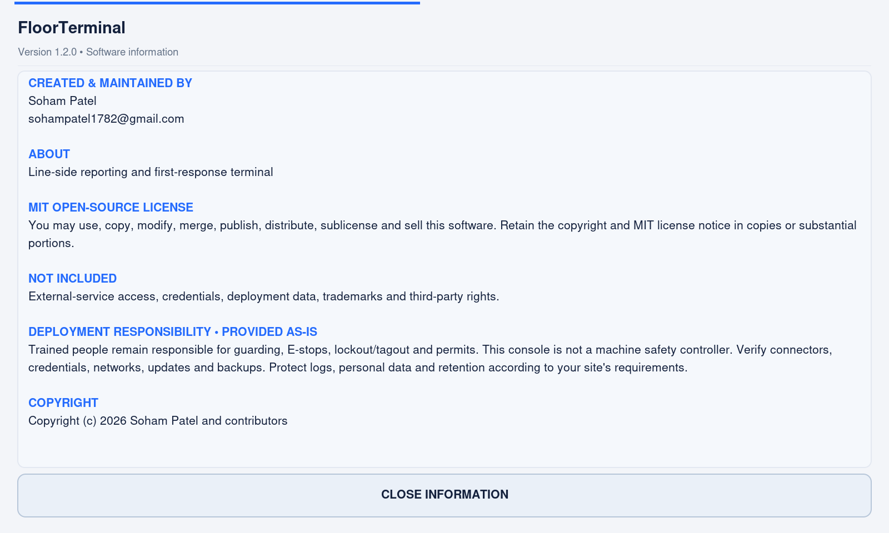

# FloorTerminal v1.2.0 — interface gallery

These images show the **released v1.2.0 application**, regenerated on a Raspberry Pi 5
on **3 November 2026**. They are native captures of real application widgets with
disposable offline examples, not design mockups or edited application screens.
The [image manifest](v1.2.0/manifest.json) records source identity, dimensions,
frame counts and SHA-256 hashes. Every current guide uses this versioned gallery;
earlier development captures have been removed from the current documentation.

## Independent station groups





Each group has its own border, stations, status and conveyor segment. A running
group keeps moving while other groups are stopped or responding. The rendered
scene is illustrative; it is not a live factory record.
[Setup and stop propagation](../station-groups.md).

## Report, respond and resume





[Station selection](v1.2.0/operator-console.png) ·
[Awaiting response](v1.2.0/line-interrupted.png) ·
[Repair in progress](v1.2.0/response-in-progress.png) ·
[Quick crew selection](v1.2.0/touch/crew-800x480.png).

## Operator self-fix and handover



[Response choice](v1.2.0/self-fix/operator-response-choice.png) ·
[Short reporting path](../operator-touch-flow.md) · [Self-fix safety and escalation](../operator-self-fix.md).

## Fullscreen settings and current release information





[Connector settings](v1.2.0/settings-connector.png) ·
[Station setup](v1.2.0/settings-stations.png) ·
[Saved team refresh](v1.2.0/team/saved-team-800x480.png) ·
[Flexible failure catalogue](v1.2.0/failures/failure-reasons-800x480.png) ·
[Current software version](v1.2.0/update-panel-current.png).

## Compact and portrait layouts

[800×480 grouped line](v1.2.0/groups/groups-800x480.png) ·
[480×800 portrait](v1.2.0/groups/groups-480x800.png) ·
[1920×1200 grouped view](v1.2.0/render/1920x1200-console.png) ·
[Portrait Settings](v1.2.0/layout/settings-0-480x800.png) ·
[Minimum viewport](v1.2.0/touch/main-320x400.png).

The application adapts to available geometry. Image dimensions are examples, not
required monitor resolutions. See [touchscreen commissioning](../adaptive-kiosk.md).

## What these images establish—and what they do not

- The source matches the v1.2.0 release; no production installation is read or changed.
- Names, incidents and department data are neutral fixtures. External connections
  are disabled or replaced by in-memory transports with sockets blocked.
- Disabled support buttons are expected without a connector. A connected indicator
  in a test-driver view denotes an in-memory fixture, not a verified real service.
- Update panels use typed status snapshots. **Hypothetical next-version screens
  are examples only**; they do not announce a version beyond the public Releases page.
- PNG images are lossless native pixels. The walkthrough WebP is lossless; the update
  GIF is reduced to 1200×720. Nothing is upscaled.
- The two conveyor clips contain 72 real-renderer frames at fixed **24-fps animation
  steps**, reduced from 1600×960 to 1200×720. They are animation demonstrations, not
  wall-clock capture or a performance claim. Native timing measurements are in
  [verification](../verification.md).
- Public attribution and support email in Information are intentional. No private
  credentials, deployment data or desktop content appears. The images and capture
  utility are covered by the project's MIT license.

## Reproduce the current gallery

Use a disposable source checkout and an isolated graphical session on a Pi. Leave
the screen untouched and do not run this over a production operator's session.
Pillow is a documentation-only dependency. The native panel needs at least
1920×1200 for the largest captures; a private Xvfb display of that size is an
alternative. On Wayland, the existing capture utility uses `grim` when necessary.

```bash
python3 docs/images/capture_release.py \
  --output /tmp/floorterminal-release-gallery \
  --logs /tmp/floorterminal-gallery-logs
```

The output folder must be empty. The orchestrator runs the existing primary
capture utility and group, operator, adaptive-layout, touch-budget, roster,
failure-catalogue, delivery, controls, native-panel and grouped-render drivers.
It fails if a driver reports an error. The script then creates two fixed-step
conveyor demonstrations and a versioned image manifest. Logs remain **outside**
the gallery and must not be published; inspect every image before replacing docs.

Only documentation assets change. Reproducing screenshots does not rebuild,
re-sign, install or publish the application, and does not require a signing key.
