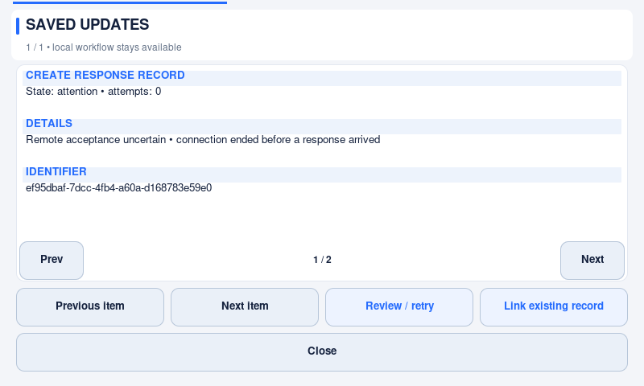

# Offline reporting and saved updates

This describes **v1.2.0**. Older installations retain their original delivery
behavior until upgraded; check the version in Information.

Independent groups share the same delivery journal. Routing is captured per
incident and asset-state ordering is per external asset, so a held write for one
cell does not block unrelated cells. See [group routing](station-groups.md).
For deliberately connector-free use, [local reporting mode](local-history.md)
records incidents without creating external jobs; this differs from an outage
in connected mode, where work remains queued.

## What an operator should expect

Confirming a report saves the incident and its external delivery instructions
together on the kiosk. The line becomes **DOWN** and its timer starts without
waiting for the internet. Planned work similarly enters **ENGINEERING** locally.
Responders can start work, change the crew and restore production while delivery
is pending. Once that physical incident is completed, another incident can be
recorded; each keeps a separate identifier and timestamps.

The feedback strip distinguishes local progress from external delivery. Touch its
queued-updates message to open **Saved updates**. Its pages explain the operation,
delivery state, attempt count, identifier and any problem. Nothing covers the
station controls or changes the physical line status merely because a network
response arrives late.

This is a neutral offline development capture, not a real service response.
[Full HD capture](images/v1.2.1/delivery/delivery-1920x1080.png).

- **Saved / queued:** recorded on this kiosk, not yet confirmed by the external
  service. Do not report the same incident again to clear this indication.
- **Sending in background:** one network worker is delivering a saved operation.
  Normal operator actions remain available.
- **Retry in …:** the service or local request budget requires a pause. Repeated
  touching does not bypass that pause.
- **Needs review / attention:** automatic replay would be unsafe, or the request
  was rejected. A responsible administrator must investigate.

The journal is not a list of emergencies acknowledged by another person. A saved
help request is not proof that someone received it. Use the site's escalation
procedure during an outage; this software is not a machine safety control.

## Rate limits and intermittent connections

Set the application's budget in **Settings → Connection → Requests per minute**.
Blank inherits the connector's default. There is no fixed maximum of ten. All
connector clients in the process share a rolling 60-second ledger, including
directory requests, diagnostics and retries. A larger setting does not override
the connected service's quota or contract.

HTTP 429 pauses delivery. `Retry-After` accepts both seconds and an HTTP date;
declared quota-reset headers also pause requests when remaining quota reaches
zero. Transient failures use bounded exponential backoff, up to 15 minutes unless
the service explicitly asks for longer. One shared pause prevents a long queue
from hammering an unavailable service. The scheduler does not sleep inside the
Tk event loop and does not create a new worker for every queued item.

Retry deadlines and delivery attempts are persisted. Restarting does not erase a
saved delivery pause. The rolling request counter itself is process-local; it is
not an account-wide quota database. Maintain a correct kiosk clock and commission
the connector's header mappings against the actual service.

Successful directory reads are retained even when the following write must wait.
Interrupted pagination resumes from its last successful cursor. This allows a
one-request-per-minute budget to make progress instead of endlessly fetching page
one. Directory snapshots are memory-only: up to 16 streams, 10,000 normalized
records per stream and 2 MiB in total. Completed page snapshots expire after five
minutes; unfinished ones expire after 30 minutes without a successful page.
The configured `directory_max_pages` still limits the search scope. Restart may
require fresh reads; the saved response journal and normalized crew roster survive.
Transient roster-refresh errors schedule another attempt after the backoff.

Chat/person and team names must be unique within the searched directory. An
ambiguous name is rejected, never silently routed to the last returned person.
Named conversations take precedence over people, as before; use distinct names
and commission the selected recipients at the site.

## What survives restart

`response_state.json` contains the physical line state, timing, selected stations,
failure notes, crew history and a bounded semantic delivery journal. It does not
contain a copy of connector credentials. Atomic writes keep a local transition
and its delivery instructions together. A failed write restores the last saved
state and displays an explicit error instead of claiming success.

Before each network write, the terminal saves its `sending` state. After a
successful response, acknowledgement and any local-to-remote record-ID mapping
are saved together. If that acknowledgement cannot be written to disk, the
process retains it and retries the **local save**, not the network write. If the
process stops first, restart uses the persisted safe-retry policy below.

Dispatch preparation and acknowledgement use the serialized local-save worker,
not the GUI thread. HTTP starts only after preparation is committed. During a
slow local save, the busy indicator acknowledges the touch and prevents conflicting
edits, including inside a dialog; animation continues. A failed acknowledgement
retries after a short delay without reissuing the network operation. An invalid
or oversized external record ID is held for review rather than saved as a broken
reference for all later operations.

The original production-release confirmation is saved before the release
transaction. If the second save fails, retry uses that first saved confirmation
time rather than extending the incident. No application can preserve information
that storage never accepted: disk-full, damaged storage and invalid state require
the site's recovery procedure. Never delete state to force a green screen.

## Duplicate prevention and administrator review

Record creation and asset-status creation require either a connector-declared,
**remotely enforced idempotency mechanism**, or explicit
`delivery: {"ambiguous_result": "hold"}`. Idempotent operations reuse their original
UUID after a timeout and restart; hold-policy operations do not automatically
repeat uncertain writes. Other operations reuse their journal UUID when their
connector declares idempotency. A header alone is not proof of deduplication: the
service or gateway must implement it, with a retention period suitable for the
site's longest supported outage.

For a non-idempotent comment, message or other write, losing a response may mean
the service accepted it. Such an operation is held for review instead of being
automatically repeated. Authentication, permissions and validation failures also
need review; retrying them continuously cannot repair configuration.

1. Open **Saved updates** and identify the affected operation.
2. Check the external system for that exact line event. Correct the connector or
   permissions if necessary.
3. If it is absent and retrying is appropriate, choose **Review / retry** and
   authorize with an administrator identity and the Settings password.
4. If a held creation already exists externally, choose **Link existing record**,
   enter its real record ID and authorize. This resolves dependent updates without
   creating another record. The administrator is responsible for checking the ID;
   linking is not an automatic remote verification.
5. For a held asset event already present externally, use **Verify existing event**.
   Verify its asset, state and original event time, enter its external event ID or
   audit reference, and authorize. This saves an attributed manual reconciliation
   without repeating the write; later events for that asset can then proceed.

Retrying still honors active quota pauses. Linking is limited to a held creation
on its original connector. Both decisions are audited. There is deliberately no
general “delete pending lifecycle work” button.

HTTP 408 after an attempted unsafe write is uncertain, not permission to replay.
Conflicts and other non-transient client errors, invalid response mappings and
oversized responses are held for review. A record and person with the same
recipient name cannot silently receive the wrong message. The connector guide
explains [route qualification and delivery policies](connector.md).

## Ordering, expiration and capacity

Creation is delivered before operations that need its remote record ID. Status
changes and participant assignments stay ordered per record; asset changes stay
ordered so a delayed OFFLINE cannot follow a newer ONLINE. A held comment or old
chat message does not prevent unrelated records or status updates from proceeding.

Lifecycle operations have no automatic expiry. Help requests, unlike historical
incident updates, become misleading if delivered long after help was needed.
After their original 15-minute window they are retained as **expired**, not sent.
An administrator can **Acknowledge expiry** to remove that expired notice from
the pending journal; the audit log records the decision. Request help again with
current conditions if it is still needed.

The delivery journal accepts up to **512 operations / 2 MiB**. This bounds memory,
disk and validation work; it is not unlimited offline storage. An incident may
produce several operations. At capacity, a new transition fails visibly and
rolls back without evicting earlier work. Restore synchronization and follow the
site's contingency reporting process. Audit-log retention does not delete pending
delivery records.

## Connector changes and crew selection

Each delivery is bound to a hash of its connector's base URL and declared identity,
plus its original asset/location context. Switching to another connection cannot
silently send old work there. Select the original connector again to resume it.
Credential rotation within the **same account** is supported without rewriting
the queue. Do not swap credentials to a different account under the same connector
identity: the application cannot infer an account boundary from a secret token.

Operations missing from the active connector remain saved and explain the missing
mapping. Features that were never enabled are not invented by the application.
An unconfigured terminal can record local incidents, but needs an appropriate
connector before those records can be delivered.

A successful team-directory lookup is cached in the owner-private state file,
bound to the connector and team. The picker shows its age. Opening it never
refetches an existing list. Refresh runs once per local day after midnight when
the kiosk is idle, or on **Settings → Connection → Refresh team members**. A
pending refresh and its retry delay survive restart; failures retain the last
verified names. If no
verified list is cached, choose **Refresh list** or explicitly **Continue without
names**, then update the crew when the directory is available. No dummy people are
assigned. Settings opens immediately with cached suggestions rather than waiting
for remote directory requests.
See [saved-team policy and recovery](team-roster.md), including empty lists,
capacity limits, account changes and stable selection while a refresh completes.

## Compatibility and testing

Do not downgrade an installation with pending journal entries or cached-roster
fields to a version that cannot read them. Older versions fail closed on unknown
state fields. Preserve the state and a backup, complete site acceptance, and use
a compatible application; do not edit away pending work to force rollback.

Active group incidents and pending archive snapshots/ID links also require a
compatible version. Finish incidents, complete archival and reconcile delivery
before considering rollback. Group configuration itself is new to 1.2.0; older
executables cannot be assumed to interpret it. Keep configuration and state
backups together and never discard unresolved work to satisfy an older schema.
The v1.2.0 updater checks these conditions before switching versions and preserves
connector files rather than replacing them with defaults. See
[update data compatibility and recovery](update-data-compatibility.md).

Offline regression tests cover complete workflows, several incidents, restarts,
partial acceptance, shared quota pauses, safe/unsafe replay, connector binding,
capacity, crew caching and failed disk acknowledgements. A separate real-Tk Pi
driver deliberately stalls a simulated write while exercising the UI. No provider
API or real credential is used. See [verification](verification.md) and
[rendering measurements](ui-performance.md). These checks are not evidence of
years of uptime; physical touch, storage, power-loss and multi-day soak acceptance
remain deployment responsibilities.

Implementation references: [HTTP Retry-After](https://www.rfc-editor.org/rfc/rfc9110.html#name-retry-after)
and [Tkinter's threading/event-loop model](https://docs.python.org/3/library/tkinter.html#threading-model).
