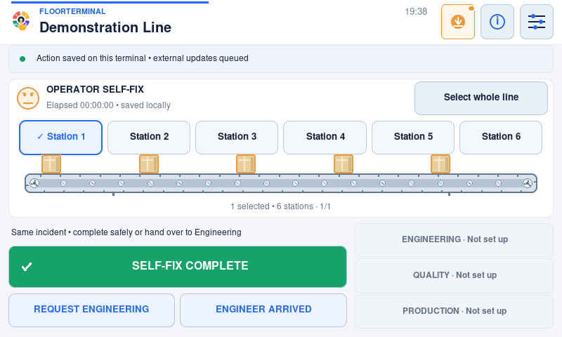
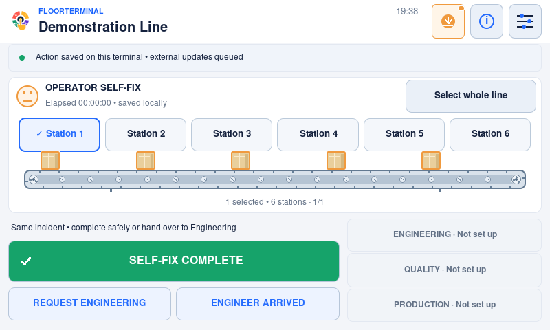

# Operator self-fix and Engineering handover

Available in **v1.2.0**; not present in older 1.1.0 installations.
This is incident reporting, not operator attendance or permission to repair a machine.
Always follow site training, guarding, isolation and escalation procedures first.

## Report a minor stoppage

1. Touch an affected station, optionally touch a failure, then **Start self-fix**
   on that same screen: 2–3 taps for the normal path. Whole-line selection opens
   the response choices directly. Work must be within site permission.
2. For multiple stations, use **Keep selection / more stations**, then select the
   next station. The same failure choices and optional Others note remain available.
3. If an operator name is useful, keep the selection, open **Report a problem →
   Optional name / details → Add / edit name**, then **Start self-fix**. A blank
   name is explicitly recorded as “Name not recorded”; it never blocks reporting.
   This optional name is not authenticated and is not an external-service user
   assignment or an attendance record. Optional entry takes additional taps.
4. **Start self-fix** saves the incident and starts the downtime
   timer at this confirmation. The line is shown as **OPERATOR SELF-FIX**. This is
   not retrospective entry: time before confirmation is not estimated.
5. After the line is safe and production is actually released, touch
   **Self-fix complete**, review the release confirmation, then confirm.

The selected stations, failures, name, category and duration remain in the report.
An operator-only completion needs no Engineering name or team assignment.

Native screen references: [response choice](images/v1.2.0/self-fix/operator-response-choice.png)
and [optional name/start confirmation](images/v1.2.0/self-fix/operator-response-setup.png).

## If help becomes necessary

Use the direct actions on the active incident; there is no help-options submenu:

| Choice | What happens |
| --- | --- |
| Request Engineering | Changes the screen to Engineering requested, assigns the configured team when supported, and queues the request to configured lifecycle chats. Original incident and downtime continue. |
| Engineer arrived | Opens the normal crew selector: tap a name to start, or Select several for batch participation. Without a directory capability it records an unnamed arrival. It hands the same record to Engineering. A prior help request is not required. |
| Self-fix complete | Allows the operator to finish before Engineering arrives. If help was already requested, the completion message also says that request is no longer needed. |

The ordinary Engineering arrival action also works after help is requested. There
is **one incident, one creation key and one response record**, not a second report.
The visible downtime timer continues from the original self-fix confirmation.
The report keeps the operator response interval and Engineering participation.
An unanswered-help escalation waits from the Engineering request, not the earlier
self-fix start. Repeated help touches do not enqueue another request.

## Categories, timers and external capabilities

**Operator self-fix** describes who responded. **MICRO-STOP** describes elapsed
time: the existing `micro_stop_threshold_minutes` determines the classification
at release. A long operator-only repair is still an operator response, but is
classified as a **DOWNTIME EVENT**, not falsely labelled a short stop.

Operator category is included in the record title/description and completion
details; Engineering handover is documented on that same record. It does not
assume the external system has a custom category field, invent user IDs, or change
Connector v1. If the connector supports a capability, the existing mapping sends it:

- Creation and In Progress / Done status use the existing response-record mapping.
- Configured asset tracking queues Offline at the start and Online at release.
- Self-fix start/completion notify Production and common activity destinations;
  they do not automatically summon Engineering. Handover notifies Engineering too.
- A missing chat/status/asset capability affects only that external feature.

Saved updates are not proof that help has received a message. Follow the site's
outage and escalation procedure if delivery is delayed. Local response, handover
and completion remain usable without network access, and the delivery journal
survives restart. No pending report is removed by automatic log cleanup.

## Recovery and compatibility

The sparse `operator_response` state contains optional display name, start,
help-request and handover timestamps. It is validated and saved atomically with
the incident and delivery instructions; a failed save rolls back the transition.
Release clears the active operator field after capturing its details in the
durable completion updates. Existing ordinary/planned incidents are unchanged.

An older executable does not understand this active field or the v1.2.0 delivery
journal. Do not downgrade during an active incident or pending delivery. Follow
[offline recovery and compatibility](offline-delivery.md), preserve state, and
never delete it just to get past validation.
