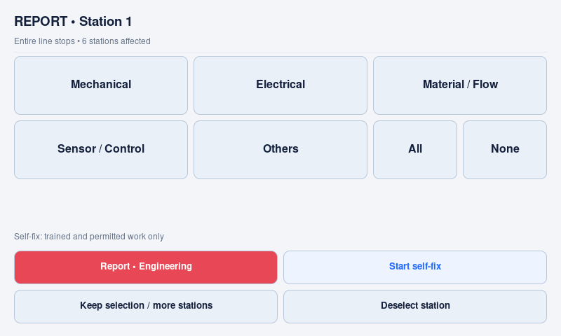
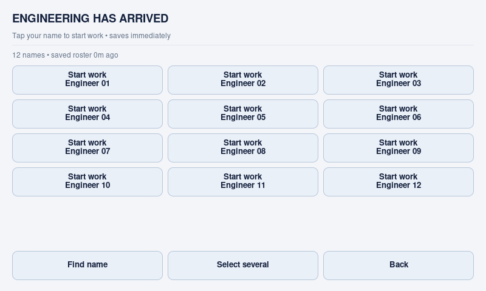
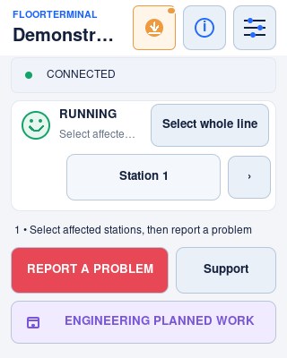
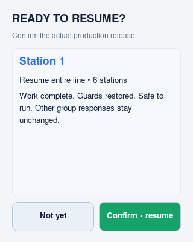

# Short operator paths — v1.2.0

These paths preserve station groups, independent incidents, multi-selection,
connector mappings, durable delivery and safety procedures. The aim is fewer
unnecessary screens, not fewer reporting capabilities.

## Normal paths

Start from the relevant incident on the main screen. Counts assume the preceding
local save has finished and the station or saved-directory name is visible.
A tap on a labelled report button records the
stop; choosing a station or reason alone does not.

| Task | Touch sequence | Taps |
| --- | --- | --- |
| Report a station, unknown reason | Station → Report • Engineering | 2 |
| Report a station and one reason | Station → reason → Report • Engineering | 3 |
| Operator minor self-fix | Station → optional reason → Start self-fix | 2–3 |
| Entire-line report | Select whole line → Report • Engineering | 2 |
| Engineering arrival | Arrival action → Start work name tile | 2 |
| One person joins or leaves | Update crew → Join / Leave name tile | 2 |
| Production release | Completion action → Confirm • resume | 2 |
| Request Engineering during self-fix | Request Engineering | 1 |
| Engineer joins a self-fix | Engineer arrived → Start work name tile | 2 |

Report actions display the actual configured stop impact. A selected station can
stop its linked group or the whole line; fewer touches do not weaken this rule.
Completion still asks for an explicit production-release confirmation. The app is
reporting software, not machine control or authorization to bypass isolation.

## Deliberate extra choices

- **Several stations:** choose **Keep selection / more stations** on each station
  sheet, then select the next. Report from the final sheet, or reopen **Report a
  problem** from the main screen. Each station keeps its own reasons and note.
- **Several reasons:** tap each, or **All**. **None** clears reasons, not the
  station. **Deselect station** removes only this station from the draft.
  With a large catalogue, use **Find** or **Back/Next**. Selected reasons remain
  selected even when filtered out. All/None applies to the whole station catalogue,
  not just the current page. Others is always visible. Search/navigation adds
  deliberate taps; the default small-catalogue reporting path is unchanged.
- **Others note:** choose Others, then **Note / more stations**. The note is
  optional. Reporting immediately with Others does not open a keyboard.
- **Several people at once:** open the crew list, choose **Select several**, touch
  names, then **Apply**. **Single tap** returns to quick mode and discards the
  uncommitted batch, restoring the saved crew. Back also leaves saved crew unchanged.
- **Large directories:** **Find name** matches display name or ID. Current crew
  appear first. The screen states how many names are visible; hidden entries are
  not silently removed from the roster or from a batch selection.
- **Many groups:** **Find group** matches name, stable ID or station. A running
  group opens report choices; a stopped group opens its existing response.
- **Optional operator name:** keep the selection, open **Report a problem →
  Optional name / details**, enter the name, then Start self-fix.

These deliberate additions can exceed 2–3 taps. Arbitrarily many stations or
people cannot all fit into a finger-sized grid on a small panel. Station arrows,
large-list filtering and administrative text/Settings navigation remain available.
Routine reporting, crew edits and completion have no scrolling or wizard pages.
Five failure reasons remain visible down to the supported 320×400 logical minimum.

## Saved state and feedback

The touch ring acknowledges contact; the busy indicator names the local operation.
A successful local save is different from external delivery: queued updates remain
visible and retry in the background. Do not report the same stop again merely
because synchronization is delayed.

During a local save or history acknowledgement, a new workflow tap may show
**Saving local changes • please wait**. That second action was not accepted or
queued: wait for the saving indicator to clear, check the current incident state,
then touch the intended action once. This brief serialization protects durable
state; it is separate from external delivery, which runs in the background.

Failure choices and a direct report commit together. Crew usage and participation
also commit together off the GUI thread. If saving fails, the error remains visible,
the report draft remains available and the crew picker resets to saved reality.
Retrying a failed Join must not accidentally become Leave.

Removing the last active engineer does **not** resume production. The incident and
downtime stay open; another engineer can join later. Self-fix handover retains the
same incident, response identity and original start time. Completion affects only
the focused incident; other groups and their timers are unchanged.

## Native Raspberry Pi previews

Captured from the actual Tk app on an isolated Raspberry Pi virtual display on
26 October 2026, with neutral fixtures, socket connections blocked and no provider
credentials. Images retain their native dimensions; they are not mockups.

## Verification and site acceptance

`tests/unit/touch_budget_driver.py` measures 65 routine paths across 320×400,
640×400, 800×480, 480×800 and 1920×1080. It verifies routed touches, durable state,
unchanged incident/timer identity, at least 44-unit targets, no overlapping targets
and no hidden failure choices. `test_quick_actions.py` separately exercises failed
saves, multiple groups/stations, batch selection and filtered rosters offline.

This does not prove usability for every person or years of uptime. Commission the
actual panel with representative operators, gloves, station names and directory
sizes. Check the configured group impact and emergency/escalation procedure.
See [adaptive display limits](adaptive-kiosk.md) and [verification](verification.md).
