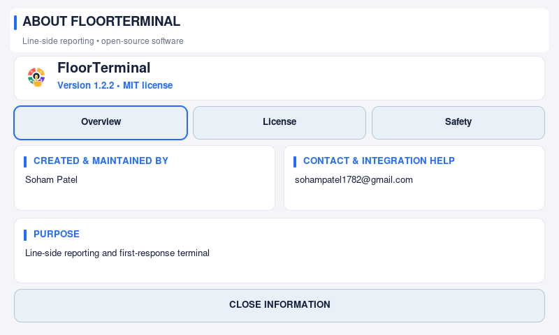
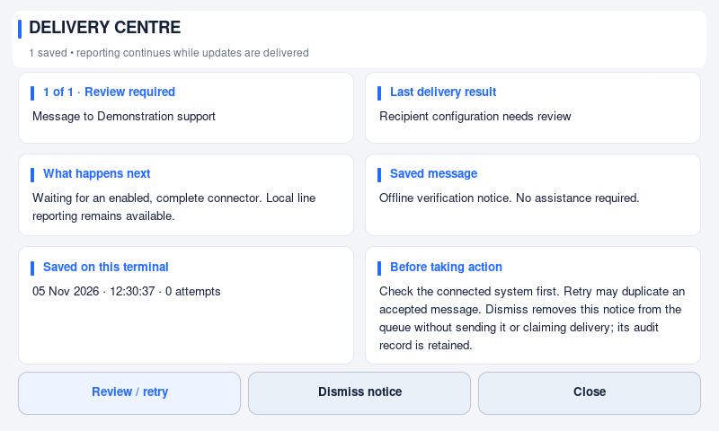

# FloorTerminal 1.2.2 — message delivery and clearer kiosk information

Released **5 November 2026**. The Linux ARM64 installation bundle and signed USB
update are available from the [v1.2.2 release](https://github.com/thesohampatel/floorterminal/releases/tag/v1.2.2).
This is an application bundle, not a bootable operating-system image.

## What changes for operators

- A compact Delivery control replaces the persistent “need review / tap for
  details” strip. Reporting and station selection keep their space.
- The delivery centre shows the destination and actual saved message, not only
  an internal operation name. Held items are shown before ordinary waiting items.
- Successful help calls receive a short confirmation after acknowledgement is
  durably saved. “Queued” still means pending, not delivered.
- An administrator can dismiss a reviewed chat notice without erasing the audit
  evidence. Required incident and equipment updates remain protected.
- Information and Software Update use responsive cards when space permits, with
  readable touch pagination on small panels. Status emphasizes the next action;
  Version retains detailed capabilities, official source and support details.

## Reliability fixes

These are native Pi captures with disposable, network-disabled examples. No
customer configuration, API account or working connector was used for images.

Corrected recipient directories are no longer overridden by an old ambiguity
cache. New help calls do not inherit the connector binding of an older incident.
Unexpired held help requests now expose their protected retry action. Literal
`local:` text in a message is not mistaken for an unresolved response-record ID.
Unexpected successful HTTP responses are held for review rather than repeatedly
posting a message accepted under an unlisted status code.

Expired help becomes reviewable even when the connector is unavailable or quota
is paused. Standalone mode labels external support controls as unavailable rather
than claiming to queue a call it will not send.

The changes preserve station groups, concurrent incidents, operator self-fix,
existing connectors, support shortcuts, offline reporting and request budgets.
No connector-schema migration or customer credential replacement is required.

## Before upgrading

The native build targets Raspberry Pi 5, 64-bit Raspberry Pi OS based on Debian 13
(glibc 2.41), and a graphical session. Obtain the installation or update archive
and its matching SHA-256 file. See [first installation](../prebuilt-raspberry-pi.md).

Finish active responses and resolve pending deliveries before installing a signed
update. Back up deployment data using your site's protected process. Do not
replace your working connector with the neutral release template. See
[software updates](../update-user-guide.md).

For help requests that remain queued or held, follow
[message delivery and troubleshooting](../message-delivery.md).
Evidence and limitations are recorded in [verification](../verification.md).
