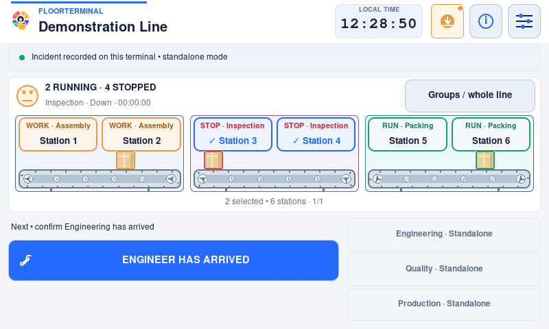
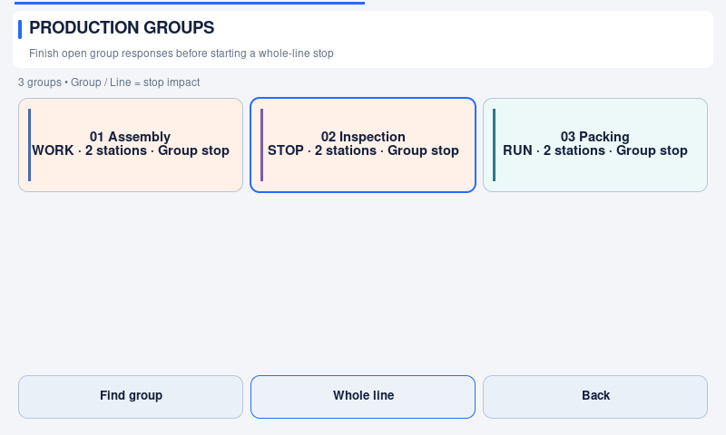
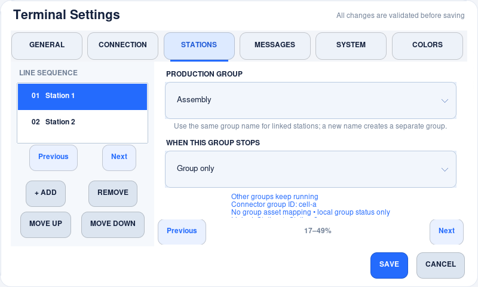

# Independent production groups (1.2.0)

FloorTerminal can represent a continuous line or several independently operating
cells on one kiosk. This is reporting and response coordination, **not machine
control**: a screen state does not operate a PLC, interlock or safety circuit.

## What a group means

- **Fault stations** are the stations the operator touches and describes.
- **Affected stations** are all stations stopped by that incident's configured
  impact. Selecting one station in a linked group stops that entire group on the
  display, but does not pretend every linked station has the same fault.
- **Group only** means other groups remain operational.
- **Whole line** means a stop reported in this group affects every station.
- **Whole line selection** deliberately affects all configured groups.

Empty `station_groups` preserves the original continuous-line behaviour: reporting
any station stops the whole line. Existing active incidents migrate conservatively
as whole-line incidents; upgrading never silently shrinks an existing stop.

## Set it up on the kiosk

1. Open password-protected **Settings → Stations & failures**.
2. Add/reorder stations and their independent failure choices as usual. Station
   names are arbitrary: a number, machine label, cell name or another site label.
   Each station has automatic **Others** and zero or more custom reasons; groups
   do not share or overwrite these lists. See [failure reasons](failure-reasons.md)
   for the paged editor, responsive picker and JSON examples.
3. Select a station. Under **Production group**, type a new group name or select
   an existing name. Give linked stations exactly the same group name.
4. Choose **Group only** or **Whole line**. Changing this choice changes the rule
   for every station belonging to that named group. The preview lists linked
   stations and explains the effect.
5. Repeat for other groups. **Save all settings** validates the entire partition:
   every station belongs to exactly one nonempty group, with unique group IDs and
   names. Invalid changes do not replace the saved configuration.
6. Reopen the station form to read the stable **Connector group ID**. Use that ID
   in the connector mapping below; the displayed group name is not a remote ID.

Group names and assignment use the existing administrator text-entry controls;
provision a physical/OS keyboard when typing Settings text. Operator response
controls and group navigation remain touch targets. Long Settings forms use the
existing large Previous/Next controls; values survive paging and rotation.

The station/group topology, failure catalogues, line identifiers and selected connector cannot be
changed through Settings while incidents are active. Complete them safely first.
Queued deliveries retain their original target snapshot, even after a later
configuration edit. Do not hand-edit runtime configuration during an incident.
If a hand edit changes an active group's topology, startup refuses to guess the
new impact: restore the saved grouping. Recovery data is preserved.

### JSON example

Keep the existing `zones` and one `station_failure_types` entry per station, then
add the group partition:

```json
"station_groups": [
  {
    "id": "assembly",
    "name": "Assembly cell",
    "stations": ["Station 1", "Station 2"],
    "stop_scope": "group"
  },
  {
    "id": "inspection",
    "name": "Inspection cell",
    "stations": ["Station 3", "Station 4"],
    "stop_scope": "group"
  },
  {
    "id": "packing",
    "name": "Packing cell",
    "stations": ["Station 5", "Station 6"],
    "stop_scope": "group"
  }
]
```

IDs use 1–64 letters, digits, hyphens or underscores. They must remain stable when
an integrator renames display labels. The GUI assigns an ID when creating a new
group name. Removing a group means moving/removing all its member stations; empty
groups are not retained. There is no fixed station-count display preset: station
cards page and the group overview uses a responsive grid with **Find group** for
additional groups. The recovery journal permits **128 simultaneous
incidents**; this is a safety capacity, not a limit on configured station count.

## Operator workflow

### Reading the production map

Each visible group segment has a shared enclosure around its stations and belt,
with a group number/name and a stable, muted identity accent. A wider gap separates
neighbouring groups. Where height permits, its header explicitly says
**Independent group** or **Stops whole line**. Compact maps keep the group identity
and operating status visible while reducing illustration detail. If a group spans
station pages, the display identifies the visible portion; its membership is not
changed by paging.

Identity accents are **not fault colours**. The operational text, station signals
and carton borders show Running, stopped or responding. The upper belt carries
cartons forward, the lower return runs in the opposite direction, and drums turn
with the belt. Only running groups move. Cartons recirculate schematically; the
animation does not claim to measure actual material flow, motor speed or PLC state.
The group overview uses the same identity accents and shows stop scope and station
counts in touch-sized cards.

### Reporting and responding

1. Touch a running station. Select optional failure types/notes. Use **Keep
   selection / more stations** when reporting several stations together.
2. Read the impact at the top of the failure sheet, then **Report • Engineering**
   or **Start self-fix**. A saved selection can also use **Report a problem**.
   Planned work uses the same group impact and
   its work-type screen shows whether all stations or only specific groups stop.
3. Only affected groups stop. Other conveyor segments keep moving. Borders,
   labels and status text distinguish Running, waiting for response and work in
   progress; the interface does not rely on colour alone.
4. Touch a different running station, or use **Groups / whole line**, to report a
   second independent incident. The first incident keeps its timer, crew,
   operator handover and queued external updates.
5. Touch a stopped station or its group in the overview to reopen that incident.
   The action buttons below apply to the **focused response**, not every group.
6. Complete only the focused incident after its affected stations are actually
   ready. Other incidents stay open. Their counters and crews are not reset.

The overview tiles show group name, current state and **Group / Line** stop impact.
Selecting a running group opens the response choices directly; it does not start
an incident until a report action is pressed. **Find group** matches group name,
stable ID or station name. Selecting a stopped group reopens its saved incident.
These shorter paths do not change group membership, connector targets or the
overlap rules below. Optional selections/search add taps; routine touch budgets
are described in the [operator touch-flow guide](operator-touch-flow.md).

Several selected independent groups can share **one incident and response
record**. They are released together. If the groups need different crews or
completion times, report them separately instead. One engineer may participate in
several incidents; the application records their selected participation but does
not claim those intervals are exclusive labour time.

### Overlap rule

One station cannot belong to two active incidents. A new request that would
overlap an open group is rejected **before any record or external update is
created**. Whole-line reporting is consequently unavailable while independent
incidents are open. Continue those existing responses; do not close unresolved
incidents merely to enable the Whole line button. Report additional independent
running groups separately where their configured impact permits it. This version
does not merge active incidents, expand their scope or model arbitrary dependency
graphs. Commission the grouping rules to match the site's operating procedure.

Fault scope is frozen once reported. Group changes do not move an active incident
to a new machine. Crew changes, operator-to-Engineering handover and completion
remain available on that incident. Unattended responses are escalated even when a
different group is currently displayed.

## Connector mapping

Physical grouping belongs in `config.json`. External identifiers belong in the
user-owned connector's optional **`workflow.group_targets`** object:

```json
"group_targets": {
  "assembly": {"asset_id": "machine-101", "location_id": "area-1"},
  "inspection": {"asset_id": "machine-202", "location_id": "area-1"},
  "packing": {"asset_id": "machine-303", "location_id": "area-2"}
}
```

This is additive to Connector v1 / contract 1.0; old connectors remain valid.
IDs are strings in this file. Existing scalar `workflow.field_types` conversions
still apply to asset/location payload fields. `asset_status_tracking` and the
connector's asset-status capability must both be enabled to send asset updates.

- Missing mapping: local response tracking still works; that group sends **no
  asset-state change**. It never silently substitutes the whole-line asset.
- One distinct mapped asset: the response record uses its scalar asset ID.
- Several distinct assets: no arbitrary first asset is chosen. Impact is included
  in the description. If supported remotely, map the optional `asset_ids` array.
- A configured top-level line `asset_id` is additionally affected only by a real
  whole-line incident. Partial group stops do not switch it Offline.
- Several groups mapped to the same asset: it goes Offline once and stays there
  until the last active affected group releases. The first stop supplies the
  external downtime classification; local records retain each incident's own
  planned/unplanned classification. Use distinct external assets if per-cell
  asset downtime is required.
- Asset delivery order is preserved per asset. A held write for one asset does
  not block an unrelated asset's stream. Connector identity remains pinned to
  the incident; changing accounts cannot silently reroute its follow-ups.

Optional `workflow.fields` mappings on **record creation**:

| Canonical field | Value |
| --- | --- |
| `incident_id` | Stable terminal incident UUID |
| `impact_scope` | `group` or `line` |
| `group_ids` / `group_names` | Lists of local group IDs / display labels |
| `reported_stations` | Stations originally identified by the operator |
| `affected_stations` | All stopped stations after propagation |
| `asset_ids` | Distinct mapped external asset IDs |
| `location_ids` | Distinct mapped external location IDs |
| `failure_details` | Array of `{station, reasons, note}` for originally reported stations |

Only explicitly mapped fields are sent; inventing unsupported provider fields
would make requests fail. Array field-type conversions apply to each element.
Group impact is also included in lifecycle comments and notifications; support
calls identify the requested groups without stopping them. Missing messaging,
assignment or asset capabilities do not disable the local group workflow.

### Match the remote asset model deliberately

Local group IDs are not remote team, location or asset IDs. A response team is a
crew assignment; a production group is the set of stations affected together.
Choosing a team does not change the group impact or machine mapping.

If the remote record accepts only one native asset/location, the scalar field is
sent only when the incident resolves to one distinct ID. Multiple assets still
receive their own queued Offline/Online events; the record description identifies
the complete scope. There is **no automatic cascade** from a parent asset to its
children and no invented multi-asset field. Map groups to the assets whose state
actually needs changing. APIs requiring a nonempty single asset for every record
need a reviewed gateway or an appropriate site model for multi-group incidents;
do not map a list into a scalar field.

Where a service accepts structured metadata, an illustrative `workflow.fields`
fragment is:

```json
{
  "group_ids": "metadata.group_ids",
  "asset_ids": "metadata.asset_ids",
  "location_ids": "metadata.location_ids",
  "failure_details": "metadata.failure_details"
}
```

The resulting failure detail has this shape:

```json
[
  {"station": "Feed.1", "reasons": ["Jam", "Others"], "note": "Guide loose"},
  {"station": "Inspection", "reasons": [], "note": ""}
]
```

Station names are literal values, not dotted field paths. Linked stations that
stopped indirectly are listed in `affected_stations`, not falsely diagnosed in
`failure_details`. Empty reasons are valid. Do not declare a scalar `field_types`
conversion for this structured array. Asset/location ID arrays can have a scalar
conversion applied to each element. This example is not a ready-to-use remote
schema: only enable mappings accepted by the service.

Before production use, commission independent stops, two concurrent incidents,
several groups in one incident, shared-asset last release, whole-line stops,
unmapped groups, restart/offline delivery, and operator-to-crew handover. Verify
the actual asset timeline and record assignments, not just comments. See the
[commissioning checklist](connector-commissioning.md).

## Restart, delivery and measurement

Every active incident and the focused view are persisted in the same atomic
recovery document as delivery intents. Background acknowledgements resolve local
record references across focused, parked and completed pending records. Existing
retry/idempotency protections apply independently to each response.

Do not sum overlapping incident durations and call the result “line downtime.”
They are **incident affected-group durations**. Computing whole-line availability
requires interval union, topology and production schedules. The local archive
retains the timestamps and scope needed for future reporting, but does not invent
OEE, throughput, uptime or labour utilisation from those intervals.

See [local reporting history](local-history.md), [offline delivery](offline-delivery.md)
and [configuration](configuration.md). Validate mappings in an authorized staging
system before enabling them on production equipment.

## Native kiosk previews

These are 1.2.1 screenshots of the real Pi/Tk interface, captured with
neutral stations in standalone mode and all sockets denied. They are not mockups
or evidence of a production service connection. Each image retains its native
resolution; click to inspect the full pixels.







[Portrait 480×800](images/v1.2.2/groups/groups-480x800.png) ·
[Full HD 1920×1080](images/v1.2.2/groups/groups-1920x1080.png) ·
[Capture provenance](images/README.md)
