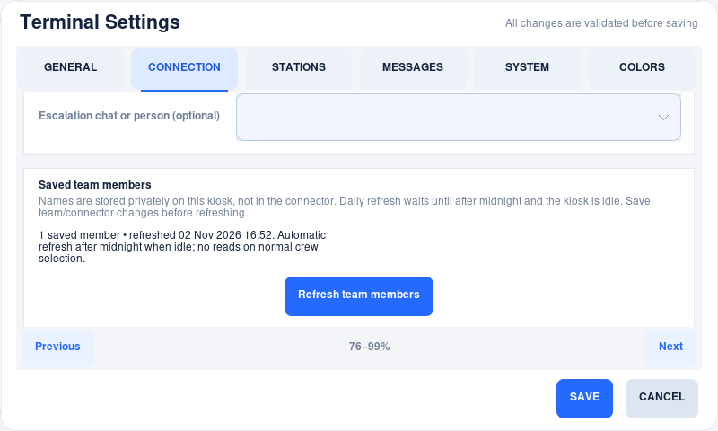

# Saved team members — v1.2.0

FloorTerminal keeps one verified Engineering roster locally. Opening the arrival
or crew-edit screen, searching names, and selecting people **do not refetch the
directory**. The list survives application/device restarts and remains usable
when the service or Internet is unavailable. Other reporting/assignment operations
still use their own API calls; this feature caches directory reads, not writes.

## Daily automatic refresh

After the local calendar date changes at midnight, the next eligible idle period
refreshes the team. This is not a fixed 24-hour timer: daylight-saving changes and
missed midnights during shutdown are handled using the device's local date.

For automatic maintenance the kiosk must have:

- No active response in any production group, unfinished station selection,
  queued delivery, open dialog, Settings page or application error panel.
- At least **60 seconds without operator input**.
- An enabled, connected team-directory capability and a saved Engineering team
  name. Local-only mode does not make directory requests.

The next successful refresh counts for that day. If the kiosk is busy at midnight,
it waits: no screen interruption, forced logout or lost selection. If it was off,
it catches up once it starts and becomes idle. There is no replay of a separate
request for every missed day. First installation uses the same idle bootstrap;
opening a crew picker without any verified list also queues the initial lookup.

Set the Pi's timezone and clock correctly. A clock/date change may make a saved
list due again; incorrect device time cannot establish reliable calendar freshness.
The application does not claim the saved directory is a real-time access-control
list or that its IDs are guaranteed to remain valid remotely.

## Refresh now in Settings

1. Open protected **Settings → Connector** (**Connection** on compact screens).
2. If editing the Engineering assignment team or selected connector, **Save**
   those changes and reopen Settings first. Refresh never uses an unsaved draft.
3. Find **Saved team members**; use the form's touch **Next** controls if needed.
4. Press **Refresh team members**. The panel shows the saved count/time and whether
   refresh is running, queued, or needs configuration review.

A manual request can refresh an already-current list and can run during a response.
It is saved before dispatch, coalesces repeated taps, and survives a restart. It
does not bypass request budgets or service cooldowns. Operational writes get first
use of the single delivery worker. Closing Settings does not cancel the refresh;
there is no need to keep a window open or leave the kiosk unusable while waiting.
Version-change maintenance/probation pauses this work.

An already-open crew picker keeps its existing selection/list stable. Close and
reopen it to see newly fetched names. A current responder absent from the refreshed
directory remains available in **Update crew** so their departure can be recorded;
refresh never silently removes someone from an active incident. Previously recorded
participation and historical names remain part of their original incident.

[Portrait layout preview](images/v1.2-development/saved-team-480x800.png).

## Offline, quota and directory errors

The last verified list is retained until a complete replacement is successfully
saved. Refresh has the same rolling API budget as other operations. A refresh is
**one directory cycle**, not necessarily one HTTP request: resolving the team and
reading paginated members can require several requests/minutes.

Transient network errors, HTTP 429 and server failures retry automatically with
increasing delays (30 seconds up to one hour), or longer when the service requires
it. Retry state is persisted and the running process uses monotonic deadlines;
reopening screens, touching Refresh repeatedly or restarting does not remove the
stored delay. Successful directory pages are reused while resuming a paused
attempt. A new daily/manual cycle revalidates the team and members rather than
returning an old short-lived directory snapshot.

Authentication, missing/ambiguous team names, invalid/incomplete directories and
capacity errors require review. They do not cause a tight retry loop. Correct the
connector/team/permissions, save any Settings changes, and request Refresh again.
Automatic retry is deferred until a later local day and an eligible idle period.
Keep your site's usual communication procedure available during outages.

A verified empty directory is saved as empty; opening it repeatedly does not
refetch it. If no selectable names are available, the existing **Continue without
names** action remains explicit. Update the crew later; no dummy people are created.

## Where the data lives

Roster data belongs to private runtime state, **not** editable configuration or
connector credentials. The existing owner-private, atomically saved
`response_state.json` contains:

| Field | Purpose |
| --- | --- |
| `roster_cache` | Connector identity fingerprint, saved team name/ID, member IDs/display names and successful refresh time |
| `roster_refresh` | Bound team/connection, pending/manual flags, attempt/retry times, bounded failure count and a non-sensitive error category |

Neither `config.json` nor the connector is rewritten to cache people. No API key,
raw response body or additional email/phone/profile fields are stored by this
feature. A service may itself use personal information in a display name. Names
and IDs are personal/operational data: keep runtime state private, protect the
device account/backups and never upload it to GitHub.

Only one roster is retained; refresh replaces it rather than growing a daily
archive. The cache is bounded to **1,000 members and 120 KiB of normalized member
data** (128 KiB for the full roster). Oversized, duplicate-ID or incomplete results
are refused, not truncated into a falsely complete list. Scope a large remote
directory appropriately. These bounds do not limit configured station counts.

Changing the configured team or connector identity makes the old roster unusable
for that new connection. A late result from the previous connection is ignored.
Ordinary credential rotation within the same declared account does not discard
valid cached names. When changing accounts behind the same URL, change the connector
identity too; the application cannot infer an account from an opaque token.

## Compatibility and commissioning

This is 1.2.0 behavior. Existing roster snapshots load without manual
migration. Connector schema remains **1**; daily caching does not require new
directory endpoints or a connector rewrite.
The new retry metadata is shared across production groups, not duplicated into
individual incidents. Older executables that cannot read populated v1.2 state
are refused by the existing downgrade checks; do not delete state to force rollback.

Offline regression tests cover repeated opens, restarts, daily/DST boundaries,
idle deferral, empty/oversized/invalid lists, binding changes, low request budgets,
long Retry-After delays, failed saves and stable open pickers. Commission real
directory completeness, remote permissions and removal semantics separately.
Cached crew selection is reporting, not proof of authorization, attendance,
training or permission to work on equipment.
