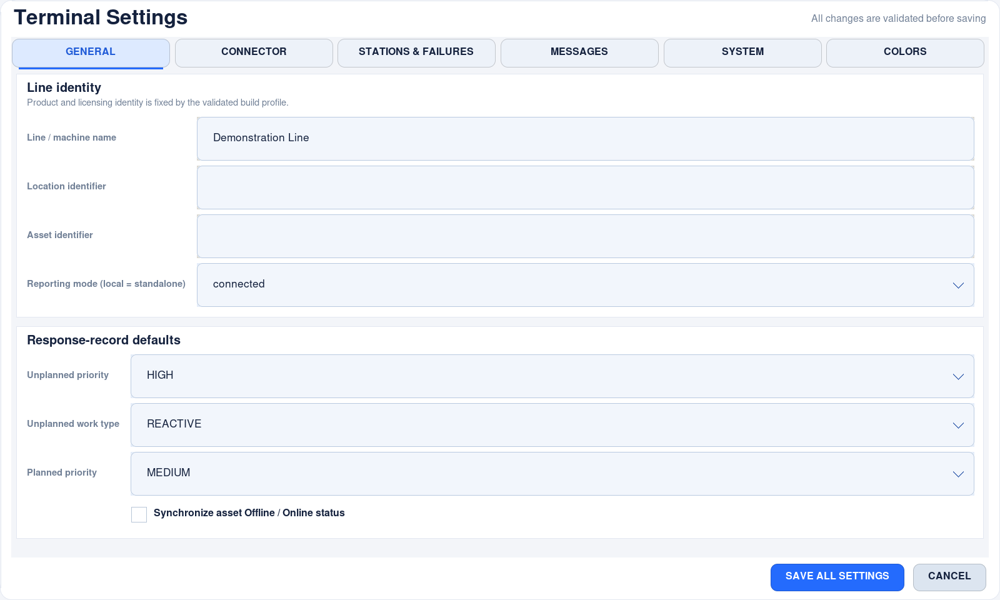
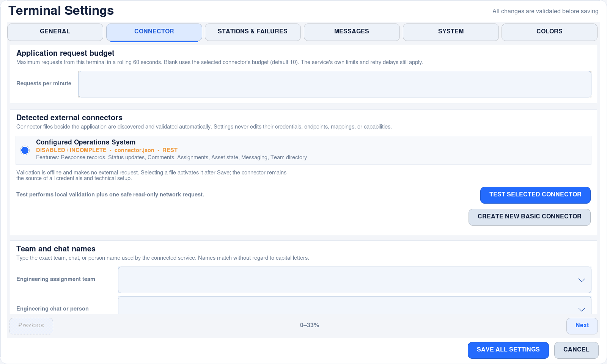
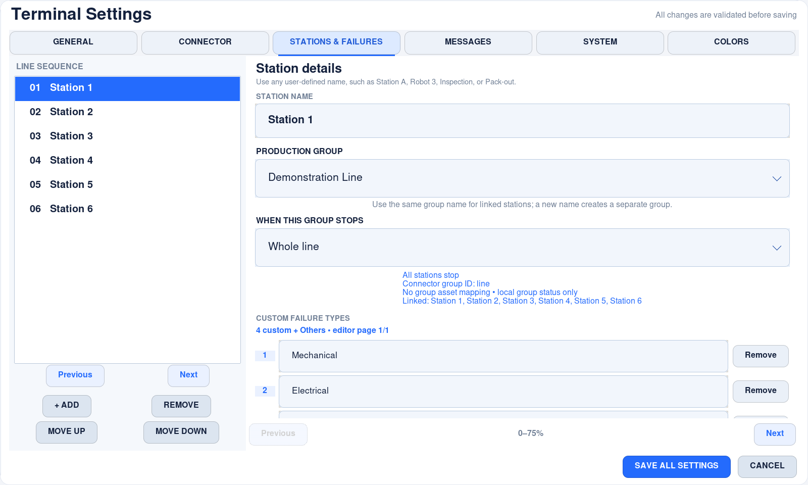

# Touchscreen rendering and responsiveness

The behavior described here is included in **1.2.0**. Dated measurements below
retain their original development context; see [release verification](verification.md)
for the final acceptance evidence and limitations.
No graphics framework or new runtime dependency is required.

## v1.2.1: bounded touch refinement

The new digital clock changes once per second inside a reserved card. Equal-size
failure grids and keyboard rows are calculated from available content space, with
only the visible page rendered. Press/release feedback uses the existing single
canvas animation chain; native Settings buttons have at most one short release
callback, cancelled on destruction. Existing image-cache bounds remain in place.
No full-screen alpha animation, live remote font/icon fetch, or per-button endless
timer is added. The additional support settings are built behind the existing
cooperative Settings loading cover.

The new offline real-Tk regression is `tests/unit/refinement_ui_driver.py`; it
checks compact, portrait and landscape layouts, all 68 number/uppercase/symbol
characters, case/delete, failure multi-selection and informational pages. Run only
on an idle test display; it blocks sockets and uses temporary runtime data.

## Animation and panel redraw fixes — 29 October 2026

The physical panel reproduced a slowdown after animation boundaries even though
individual Python render calls were inexpensive. Retained rendering only helps
when the scene remains structurally stable: replacing two eye shapes during a
blink or conditionally omitting carton components shifts/recreates later slots,
which can invalidate much more of the drawable than the moving object itself.

Eyes now use the same primitive while blinking. Every moving carton retains all
its components across recirculation. Belt seams follow a continuous carry/return
loop, with rotating drums and idlers, and bounded per-group motion clocks. Stopped
groups hold their position; resume never tries to replay missed frames. A
1,000-frame regression crosses multiple blink and wrap boundaries and checks the
operation structure. The stress driver additionally reports recreated canvas
items after warm-up; it does not infer display smoothness from Python timings alone.

The static header identity is precomposed onto an opaque RGB surface and displayed
outside the animated drawable. Small field chevrons use preblended edges and a
binary mask. This avoids Tk's partial-alpha drawable-readback path; it is an
additional rendering precaution, not a claim that alpha was the only cause of the
reported slowdown. Original assets remain unchanged.

Settings constructs its sections cooperatively behind a fullscreen loading cover.
Only the finished page is exposed. Back cancels pending construction, and a failed
section returns to the recoverable error panel without saving partial settings.
Unmapped one-pixel geometry is ignored, and grids are reconfigured only when their
wide/narrow layout changes. Native controls stay stationary during transitions;
only the small category/page accent animates. Moving a large native-widget tree
per frame creates avoidable Configure and redraw traffic on a kiosk display.

Rounded panel backgrounds use four small corner surfaces plus native rectangular
fills/edges, rather than allocating a full-screen image. Tests bound their raster
cache below 128 KiB even at 3840×2160. Shared touch-button faces are capped at 48
variants and 8 MiB estimated decoded bytes; live buttons retain references after
eviction. Field assets are shared per Tcl interpreter. These bounds apply to the
named caches, not total application memory.
Option sheets explicitly remove their Tcl variable traces on destruction. The
repeated-open/close regression checks that Tcl command and font counts stay stable
after warm-up, including when the parent destroys the picker rather than Back.

The physical-panel diagnostic uses real `Tk.mainloop()` for its timing sample,
checks for accidental navigation during that sample, and accepts 2–300 seconds:

```sh
FLOORTERMINAL_DISABLE_NETWORK=1 PYTHONPATH=src python3 tests/unit/panel_ui_driver.py --seconds 120 --capture /tmp/floorterminal-panel-check
```

Run it only on an idle test panel: it takes the screen temporarily, uses disposable
standalone data, disables updates/sound and denies socket connections. Do not touch
the display during automation. Results measure application scheduling and render
calls, not physical input latency or compositor/display scan-out. A short test
cannot guarantee continuous multi-day operation; a representative soak remains
required. Earlier dated results below describe earlier snapshots, not this revision.

### Measured on the attached Pi 5

On the 1920×1200 Wayland/labwc panel, Python 3.13.5 / Tk 8.6, an uninterrupted
120-second mainloop run recorded **3,628 frames** (30.2 fps), **2.95 ms p95 render
call**, a **30.09 ms maximum nominal 20-ms heartbeat gap**, and **9.72% process CPU**
relative to one core. The static password page rendered two frames in two seconds
and used 0.64% process CPU. No callback errors or external connections occurred.

Settings showed its loading feedback in **106 ms** and completed in **1.42 s**.
Its maximum measured build-time heartbeat gap was **502 ms**: initial native
control construction still has a short pause. This is not a claim of instantaneous
opening or zero latency. Unfinished controls stay covered, and the stationary
final page avoids animated whole-form redraws. All six category footers passed
actual pointer-hit checks, not just geometry checks.

An additional grouped-render run used synthetic 180-day phases, 200 warm-up
frames and 2,000 measured frames per size, including Tk idle drawing:

| Viewport | p95 frame | Canvas items | New items after warm-up | RSS growth |
| --- | ---: | ---: | ---: | ---: |
| 800×480 | 2.348 ms | 218 | 0 | 64 KiB |
| 480×800 | 1.303 ms | 152 | 0 | 0 KiB |
| 1920×1200 | 3.441 ms | 272 | 0 | 0 KiB |

Synthetic phases test arithmetic and resource behaviour; they are not 180 days
of elapsed execution. The native panel was approximately 42°C before these
checks with no reported throttling. No display mode, cooling safeguard, production
installation or runtime data was changed. Tests use disposable local data.

## Attached-panel check — 27 October 2026

The opt-in `tests/unit/panel_ui_driver.py` was run on a Pi 5 ARM64 with its attached
1920×1200 touchscreen, Wayland/labwc at scale 1, Python 3.13.5 and Tk 8.6. The app
entered fullscreen normally, used disposable standalone data and denied sockets.
There was no Xvfb and no provider traffic.

Over a 10-second normal event-loop sample, the animated main page rendered **294
frames**, with **2.30 ms p95 render-call time**, **36.64 ms maximum interval**
between nominal 20-ms heartbeat callbacks, and **8.96% process CPU** (relative to
one CPU core, including the test pump). The static password-page sample rendered
two frames in two seconds, with 1.77 ms p95 render-call time and a 21.43 ms maximum
heartbeat interval. No Tk callback or application error panel was reported.

These numbers exclude physical touch acquisition, compositor presentation and
display scan-out. They are a short observation, not a latency guarantee or a
long-run benchmark. The device was already around 82°C before launching the app;
thermal flags were observed and no cooling/power safeguards were changed. A
properly cooled enclosure and a representative soak remain deployment checks.

Native screenshots of the main page, Information/password pages, workflow dialogs
and Settings were inspected. The test capture path now shares the documentation
tool's X11/Wayland support: region-only `grim` fallback with a timeout when Pillow's
XWayland capture fails. Captures stay outside the repository by default; no new
application dependency or product layout change is required for these checks.

## Pi kiosk efficiency review — 27 October 2026

Full-viewport dialogs previously drew the production map underneath their opaque
background. The renderer now draws only the visible page. A static dialog uses a
one-second fallback refresh; input, resize and worker results still invalidate
immediately. A touch wakes the existing animation timer for its brief contact
ring; busy pages retain a faster refresh. The main animation interval is unchanged.

Before/after measurements use the same Raspberry Pi 5 ARM64 / Python 3.13.5 /
Tk 8.6 private display, with 200 warm-up frames followed by 2,000 measured frames
per scene/size/revision (24,000 measured frames). Network calls are disabled.
The baseline is the preceding committed source; only the benchmark's new
`--dialog` selector is added to that test copy.

| Page | Viewport | Previous p95 | Optimized p95 | Optimized canvas items |
| --- | --- | ---: | ---: | ---: |
| Information | 800×480 | 1.727 ms | 0.343 ms | 24 |
| Information | 1920×1080 | 3.032 ms | 0.352 ms | 27 |
| Failure selection | 800×480 | 1.533 ms | 0.290 ms | 27 |
| Failure selection | 1920×1080 | 2.228 ms | 0.355 ms | 27 |
| Crew | 800×480 | 1.390 ms | 0.184 ms | 15 |
| Crew | 1920×1080 | 2.162 ms | 0.183 ms | 15 |

This is approximately 80–92% less elapsed render time for these scenes, not an
80–92% improvement to all application work. Optimized RSS growth after warm-up
was 0 KiB in these runs. The 800×480 Information capture is pixel-identical to the
baseline; no logo, font, layout or workflow action was changed.

A separate grouped main-screen run at synthetic 180-day animation phases measured
3,000 frames per viewport:

| Viewport | Mean frame | p95 frame | RSS change after warm-up |
| --- | ---: | ---: | ---: |
| 800×480 | 1.060 ms | 1.186 ms | 16 KiB |
| 480×800 | 0.812 ms | 0.811 ms | 0 KiB |
| 1920×1080 | 1.493 ms | 1.530 ms | 0 KiB |

A mean can slightly exceed p95 when a few slower frames affect the mean. These
short runs do not establish physical touch latency or continuous months of uptime.
The existing blocked-network/storage heartbeat tests remain in the full suite.

```bash
FLOORTERMINAL_DISABLE_NETWORK=1 PYTHONPATH=src python3 tests/unit/render_stress_driver.py --dialog about --frames 2000 --sizes 800x480 1920x1080
FLOORTERMINAL_DISABLE_NETWORK=1 PYTHONPATH=src python3 tests/unit/render_stress_driver.py --groups --frames 3000 --sizes 800x480 480x800 1920x1080
```

See [Pi kiosk hardening and commissioning](pi-kiosk-hardening.md) for file
boundaries, audio limits, hardware checks and acceptance requirements.

## Rendering design

The dated sections retain separate virtual-display and physical-panel development
measurements; do not compare their frame timings as equivalent workloads.

Views describe the visible scene in logical coordinates. `ResponsiveCanvas`
retains the underlying Tk items through `CanvasScene`; unchanged text, images and
styles cause no Tcl configuration call. Moving rollers, belt seams and cartons
update their coordinates. Structural changes restore the actual stacking order
and delete unused items. The pool is bounded by the current scene, not the number
of frames or stations ever visited.

The anti-aliased shape cache is limited to 256 entries **and** 24 MiB of estimated
decoded RGBA image bytes. Compressed PNG size is not used as a memory estimate.
Visible scene items own their images independently so cache eviction cannot make
a button disappear. Color lookup caches are also bounded. Visible image memory,
Tk/X11 resources and the rest of the application are additional to the cache budget;
24 MiB is not a claim about total process memory.

Completed retry deadlines cannot accumulate indefinitely: their recent-use cache
is capped at 512, with the durable outbox left unchanged. Evicted entries are
reconstructed conservatively from saved timestamps. The automatic device-care
worker checks about once a minute without taking the operator busy lock. Audit
writes use one bounded asynchronous writer, rather than making touch handlers wait
for log I/O. See [bounds, overflow and durability](automatic-device-care.md).

One cancellable animation timer owns periodic rendering. Frame work is subtracted
from the requested interval; missed frames never become a catch-up queue. At least
10 ms of event-loop time remains between frames, with extra backoff for expensive
frames. A hidden window does not render. Settings stops main-screen painting;
opaque dialogs use a slower cadence. Touch/keyboard/resize input independently
requests one coalesced idle repaint. Shutdown cancels pending repaint/frame timers.

New configurations use `animation_interval_ms: 33` (about 30 fps). Existing
configuration is not overwritten: change **Settings → System → Animation interval**
to 33 if the installation still uses 80. Actual frame rate also depends on the
display/compositor, thermal conditions and other applications.

## Interaction and panels

- An accepted control press depresses its button and draws a short touch ring.
- During an operation the reserved header area shows the operation, a spinner and
  elapsed seconds. Tap the feedback band to read the full message. This is
  acknowledgment, **not** a claim that a remote service has accepted the data.
  An operation started in the Software Update panel shows progress in that
  panel's header instead of leaving it hidden behind the modal backdrop.
- The busy pointer and operation lock last until the operation result is handled.
  A background identity lookup cannot release that lock. Repeated presses do not
  create duplicate operations. Existing durable queuing/idempotency rules remain.
- Settings is one app-owned, rounded panel. It remains within the parent window;
  fonts and button faces adapt when resized. Save/Cancel stay outside scrollable
  content. The connector wizard is nested inside Settings and returns input
  ownership when closed. Changing the password temporarily returns to the protected
  canvas dialog and then restores unsaved Settings edits.
- Buttons retain native Tk keyboard focus, disabled state and invocation. Their
  cached rounded faces use hover/pressed color changes, not continuous decoration.

## Reproducible offline measurements

From the project root, in a desktop session or a private Xvfb display:

```sh
PYTHONPATH=src python3 -m unittest discover -s tests -t .
PYTHONPATH=src python3 tests/unit/render_stress_driver.py --frames 2000
PYTHONPATH=src python3 tests/unit/render_stress_driver.py --legacy-redraw --frames 2000
```

The driver creates disposable runtime data with no connector credentials, disables
update networking and rejects connector transport calls. It advances the animation
phase as though the app has run 180 days. `--legacy-redraw` compares delete/recreate
versus retained rendering in the **same current source and cache policy**; it is
not a benchmark of a separately installed old release. It reports actual render
and idle-paint time, CPU time, item/image counts and Linux resident memory growth.
Use `--screenshots /path/outside/the/repo` for visual checks (optional Pillow).

Initial retained-rendering measurements, **before the adaptive layout refactor**,
on Raspberry Pi 5 / Raspberry Pi OS 64-bit, Python 3.13.5, Tk 8.6, private
Xvfb, 11 October 2026; 200 warm-up frames followed by 2,000 measured frames per size:

| Viewport | Delete/recreate mean | Retained mean | Retained p95 | RSS growth after warm-up |
| --- | ---: | ---: | ---: | ---: |
| 800 × 480 | 15.890 ms | 2.725 ms | 3.180 ms | 144 KiB |
| 1280 × 800 | 19.616 ms | 4.008 ms | 4.555 ms | 0 KiB |
| 1920 × 1080 | 23.775 ms | 5.427 ms | 6.689 ms | 0 KiB |

A separate 30,000-frame retained-renderer stress run (15,000 frames each at
800×480 and 1920×1080, before the final conveyor simplification) showed 544 KiB
and 0 KiB resident-memory growth after warm-up, respectively. Resource tests also
cover 10,000 identical frames, 10,000 cache inserts and 10,000 retry deadlines.

These are renderer measurements, not guaranteed physical touch-to-photon latency.
Virtual-display tests do not reproduce every compositor, touchscreen driver,
thermal state or multi-day workload. Before production deployment, perform a
multi-day soak on the actual panel with representative offline queue/reconnect
activity, monitor CPU/memory/temperature, and verify touch, sound and restoration.
No live third-party API was used in development verification.

### Adaptive-layout renderer check — 13 October 2026

The same Pi/Tk environment ran 3,000 frames per viewport after 200 warm-up
frames, with the new adaptive layout and a credential-free, connector-disabled
configuration. These measure the source at that dated checkpoint, not a comparison of
identical scenes with the older layout.

| Viewport | Mean frame | p95 frame | RSS growth after warm-up |
| --- | ---: | ---: | ---: |
| 800×480 landscape | 1.079 ms | 1.119 ms | 0 KiB |
| 480×800 portrait | 0.905 ms | 0.924 ms | 0 KiB |
| 1920×1080 landscape | 1.769 ms | 1.811 ms | 0 KiB |

The 9,000 measured frames use synthetic 180-day animation phases. They are not a
multi-day live deployment test. The revised operator layout uses fewer drawing
items while preserving workflow, line status, paging and feedback.

## Released v1.2.0 interface

For operator and narrow Settings layouts, see
[adaptive kiosk previews](adaptive-kiosk.md#native-previews). The Settings images
below were regenerated from the corrected v1.2.0 source on **3 November 2026**;
they do not depict the earlier dated performance checkpoints.

These are native 1600×960 captures of the real Pi UI using disposable offline
fixtures, not mockups or evidence of a live external-service connection. See the
[gallery provenance](images/README.md). Longer forms use touch paging and optional
scrolling; the Save/Cancel footer stays visible.







## Background-delivery verification — 21 October 2026

The delivery worker has no ownership of the operator's busy flag and receives no
Tk widgets or live state dictionary. Automatic retries use durable deadlines, not
event-loop sleeps. A blocked simulated write was exercised with actual Tk touches
on the Pi: Information opened and closed, repair began, and production was released
before the write returned. The standalone driver recorded 100 heartbeat samples
with a maximum interval of 70.17 ms and no callback faults.

The renderer at that dated checkpoint ran 5,000 measured frames per viewport after 200
warm-up frames. Animation phase was advanced synthetically to 180 days:

| Viewport | Mean frame | p95 frame | RSS change after warm-up |
| --- | ---: | ---: | ---: |
| 800×480 | 1.099 ms | 1.157 ms | 80 KiB |
| 480×800 | 0.907 ms | 0.914 ms | 0 KiB |
| 1920×1080 | 1.706 ms | 1.803 ms | 0 KiB |

These private Xvfb measurements isolate rendering and simulated networking. They
do not measure physical touch latency, slow/failing storage, a real provider, or
months of continuous operation. A multi-day site soak remains necessary.

Reproduce on an isolated graphical session with no real deployment data:

```bash
PYTHONPATH=src python3 tests/unit/delivery_ui_driver.py
PYTHONPATH=src python3 tests/unit/render_stress_driver.py --frames 5000 --sizes 800x480 480x800 1920x1080
```

Both drivers create temporary neutral deployments; the delivery driver blocks
sockets and uses an in-memory transport. Current release captures are linked
from [Saved updates](offline-delivery.md).

## Operator response and device care — 24 October 2026

After the operator-response and fullscreen-panel changes, the same isolated Pi/Tk
renderer check ran 3,000 measured frames per viewport, following 200 warm-up
frames. Animation phase again represented a synthetic 180 days of uptime:

| Viewport | Mean frame | p95 frame | RSS change after warm-up |
| --- | ---: | ---: | ---: |
| 800×480 | 1.106 ms | 1.130 ms | 0 KiB |
| 480×800 | 0.916 ms | 0.929 ms | 0 KiB |
| 1920×1080 | 1.742 ms | 1.823 ms | 0 KiB |

An additional real touch-through driver (`tests/unit/operator_ui_driver.py`)
records and completes an operator self-fix, then repeats with Engineering request
and arrival. It checks saved state and one creation per incident, with all sockets
denied. The full suite also retains its blocked-write responsiveness check.

Audit writes now use one bounded writer: callers snapshot and cap JSON payloads,
but do not perform log filesystem I/O. Rotation and adaptive cleanup never delete
the workflow journal. Device checks run separately about once a minute. See
[device-care bounds and failure behaviour](automatic-device-care.md).
These changes do not establish uninterrupted months/years of physical operation.

## Independent groups — 25 October 2026

The private Pi/Xvfb renderer was exercised with one stopped group, one group under
response and one running group. Each viewport used 200 warm-up frames followed
by 3,000 measured frames, with animation phase advanced synthetically to 180 days.
Only running conveyor segments move; grouped status does not spawn extra animation
timers or network workers.

| Viewport | Mean frame | p95 frame | RSS change after warm-up |
| --- | ---: | ---: | ---: |
| 800×480 | 1.057 ms | 1.210 ms | 64 KiB |
| 480×800 | 0.811 ms | 0.811 ms | 0 KiB |
| 1920×1080 | 1.493 ms | 1.502 ms | 0 KiB |

The small portrait mean/p95 equality is rounding, not a universal frame-time
guarantee. Native virtual-display rendering is not physical-panel latency, disk
latency, real-service acceptance or a multi-month soak.

```bash
PYTHONPATH=src python3 tests/unit/group_ui_driver.py
PYTHONPATH=src python3 tests/unit/render_stress_driver.py --groups --frames 3000 --sizes 800x480 480x800 1920x1080
```

Both tools isolate runtime data; the group touch driver denies all socket
connections. The full test suite also retains blocked-network responsiveness
checks. Local archival uses one bounded writer and asynchronous durable
acknowledgements; it never executes SQLite work in the renderer. See
[archive design and limits](local-history.md).

## Recovery and slow-storage follow-up — 26 October 2026

Delivery preparation and acknowledgement, and operator station/failure selections,
now use the local-operation worker. The UI shows saving progress until commit;
the next dialog opens only on success. Conflicting modal actions/keyboard submits
cannot change state mid-commit. This follows Tk's
[event-loop/threading model](https://docs.python.org/3/library/tkinter.html#threading-model):
widgets are handled on the GUI thread, blocking persistence is not.

The offline delivery driver now stalls four real state writes for 800 ms each.
It checks that they run off the main thread, the event loop continues, and only
one external record is created. An isolated Pi run measured maximum heartbeat
gaps of 31.09 ms under these storage delays and 29.61 ms during blocked simulated
network delivery. The regression threshold is 500 ms to catch blocking work,
not to claim a frame-rate guarantee.

The final grouped scene was rerun with 200 warm-up frames followed by 3,000
measured frames per viewport, with synthetic 180-day elapsed animation time:

| Viewport | Mean frame | p95 frame | RSS change after warm-up |
| --- | ---: | ---: | ---: |
| 800×480 | 1.058 ms | 1.097 ms | 0 KiB |
| 480×800 | 0.821 ms | 0.834 ms | 0 KiB |
| 1920×1080 | 1.519 ms | 1.543 ms | 0 KiB |

These are renderer measurements on a virtual display. They do not replace
physical-panel, SD-card, power-loss or multi-day deployment acceptance.

## Short touch flows — 26 October 2026

The routine failure/crew/release renderers are isolated in
`ui/operational_dialogs.py`. They calculate bounded grids from the existing kiosk
viewport and reuse the existing retained-canvas renderer. No extra animation
worker or polling loop was introduced. Crew usage and participation persist in
one worker transaction; report drafts and report creation also commit together.

A final ordinary running-line check measured 3,000 frames per viewport after
200 warm-up frames at synthetic 180-day animation phases:

| Viewport | Mean frame | p95 frame | RSS change after warm-up |
| --- | ---: | ---: | ---: |
| 800×480 | 1.143 ms | 1.174 ms | 16 KiB |
| 480×800 | 0.958 ms | 0.970 ms | 0 KiB |
| 1920×1080 | 1.794 ms | 1.890 ms | 0 KiB |

The native touch-budget driver separately verifies 65 complete action paths and
batch selection through a filtered 200-name directory. Rendering cost and tap
counts are different measurements: neither establishes physical input latency,
continuous multi-day uptime or remote-service acceptance. See
[verification](verification.md) and [touch flows](operator-touch-flow.md).
